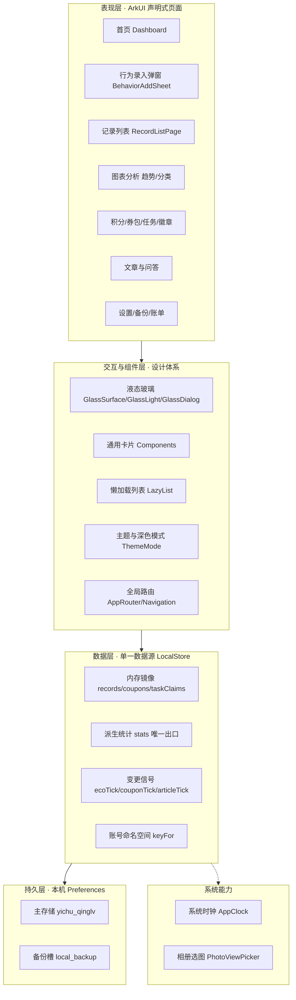
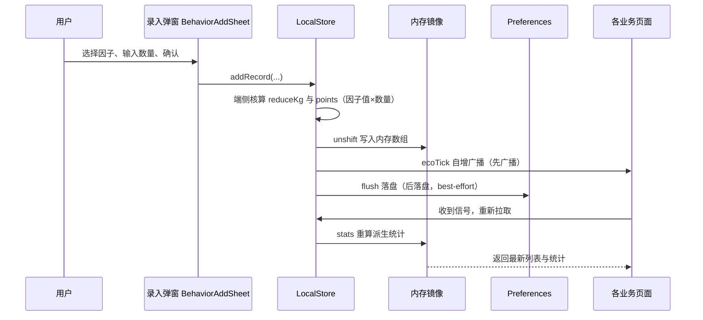
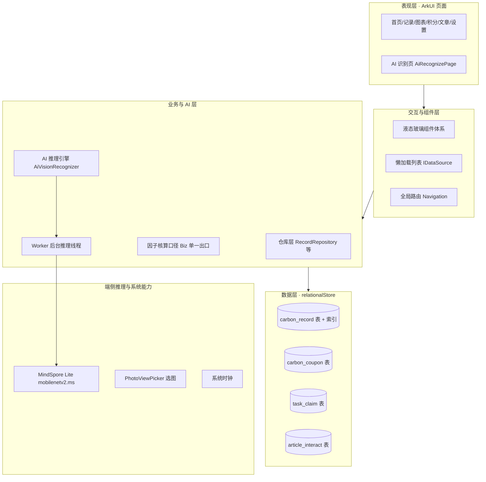
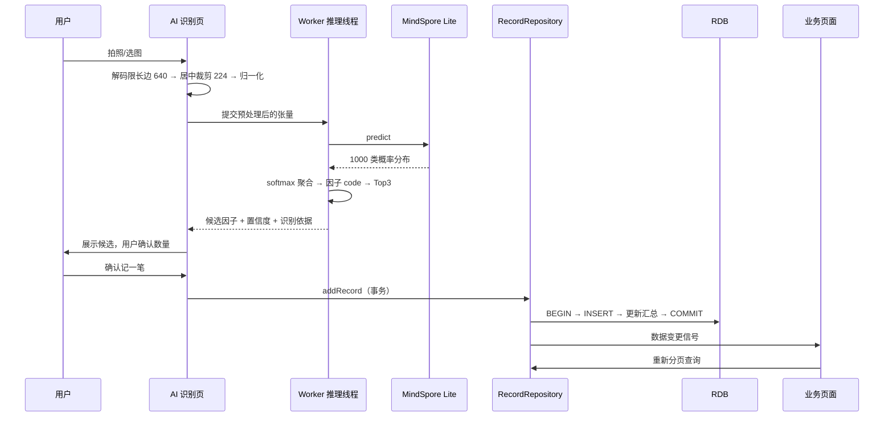

# 一触青绿 · OpenHarmony 单机版技术方案（两套）

> **文档定位**：本文档面向「一触青绿」鸿蒙端的单设备本地运行场景，给出两套可落地的技术方案，均基于 OpenHarmony + ArkTS + ArkUI（API 24），不依赖任何服务端与网络能力。
>
> **落地状态（2026-10-23）**：**方案二「RDB 关系库 + 按需读取」已按本文口径落地**——`data/rdb/CarbonRdb.ets`（relationalStore 五表 + 索引 + 聚合下推 + 分页 + 事务）已实现，`LocalStore` 改为 RDB 仓储（Preferences 仅留登录态/种子标记/备份计数等轻量键值），带一次性迁移器与预览器内存态兜底。方案一的口径可作为演进背景阅读。
>
> **粘贴进 Word 的操作提示**：
> 1. `#`/`##`/`###` 标题层级在 Typora、WPS、Word 的 Markdown 导入中会自动映射为「标题 1/2/3」，对应 Word 大纲级别，可直接生成目录；
> 2. 所有表格均为标准 Markdown 表格，可直接粘贴为 Word 表格；
> 3. 架构图与流程图同时提供 **Mermaid 代码**（适合后续渲染为图片插入）与**文本线框图**（可直接粘贴）；
> 4. 文中代码块为节选示意，正式排期以注释中的口径为准。

---

## 一、项目概况与方案前提

### 1.1 项目简介

「一触青绿」是一款面向个人用户的**碳足迹记录与碳积分激励**应用：用户将日常低碳行为（步行、骑行、公交、自带杯、节电等）记录为碳减排量，按统一口径折算为碳积分，积分可在本地积分商城兑换权益（植树认养、碳惠券等），配合任务、徽章、证书形成激励闭环。

### 1.2 目标设备形态

| 项 | 说明 |
| --- | --- |
| 设备类型 | 手机（Phone）单设备 |
| 系统底座 | OpenHarmony，ArkTS + ArkUI 声明式开发 |
| API 版本 | API 24（DevEco Studio） |
| 路由方案 | Navigation 全局路由 |
| 运行模式 | 单进程本地运行，无网络请求，数据不出设备 |

### 1.3 核心功能清单

| 功能域 | 内容 |
| --- | --- |
| 碳足迹记录 | 27 项行为因子库、手动录入、数量步进、备注 |
| AI 辅助录入 | 拍照/选图端侧识别，输出候选低碳行为与置信度 |
| 统计与图表 | 今日/本月/累计减排、连续打卡、等级、趋势图、分类占比 |
| 积分激励 | 积分核算与余额、每日任务领取、积分商城兑换 |
| 权益凭证 | 碳惠券包、核销凭证、植树证书、徽章墙 |
| 内容社区 | 低碳文章、点赞收藏、知识问答 |
| 本地管理 | 数据备份/恢复、月账单、报告导出、深色模式、清空数据 |

### 1.4 当前进度

| 模块 | 现状 | 说明 |
| --- | --- | --- |
| 鸿蒙端工程骨架 | 已完成 | API 24，约 60 个页面/组件文件，Navigation 全局路由 |
| 本地数据底座 | 已完成 | LocalStore（内存镜像 + Preferences 落盘）+ MockStore（确定性种子数据） |
| 数据源适配层 | 已完成 | DataSource 已本地化，页面调用方式保持不变 |
| 碳核算与激励 | 已完成 | 1 kgCO₂e = 10 积分；3000 积分兑换 1 棵树；任务/券包/徽章/证书/商城均已本地闭环 |
| UI 设计体系 | 已完成 | 液态玻璃组件（GlassSurface/GlassLight/GlassDialog）、深色模式、材质三档参数 |
| 端侧 AI 识别 | 原型可用 | MindSpore Lite + mobilenetv2，「选图 → 推理 → 因子映射 → 入账」链路已跑通 |
| 备份与恢复 | 已完成 | Preferences 备份槽 + 备份格式版本兼容 |

### 1.5 两套方案的共同前提

1. 运行范围严格限定为：**单设备、单进程、纯本地**；
2. 全部数据存放于设备本机存储（Preferences 或本地关系库）；
3. 备份/恢复均在设备本机存储内完成，不涉及任何跨设备数据流动；
4. 技术栈限定 ArkTS + ArkUI + OpenHarmony 本地 Kit（ArkData / MindSporeLiteKit / MediaLibraryKit / CoreFileKit）。

---

## 二、方案一：轻量内存镜像架构（现状加固型）

### 2.1 背景与目标

**背景**：当前单机链路已经可用，本地数据底座、UI 体系、AI 原型均已落地，但轻量方案在数据规模增长下会暴露三类问题——Preferences 全量 JSON 随记录数线性膨胀、多键写入缺少原子性、演示数据与真实数据的边界依赖版本标记维护。

**目标**（4 周，1–2 人）：

1. 把现有 LocalStore 内存镜像方案**规范化**：键名收敛、读写时序统一、派生统计口径单一出口；
2. 把 UI 资产**体系化**：液态玻璃组件收敛复用，深色模式全量走查；
3. 建立**性能与功耗基线**，给出明确的数据规模警戒线与降级策略。

### 2.2 核心重点

#### 重点 1：本地数据层——单一数据源与内存镜像

- **LocalStore 是唯一数据源**：所有业务页面只经 DataSource 访问 LocalStore，不各自持有数据副本；
- **内存镜像 + 变更后落盘**：`init()` 一次性读盘进内存，之后页面同步读取、零 loading；写入先改内存，再 best-effort 落盘；
- **先广播、后落盘**：写入成功后立即自增变更信号（ecoTick / couponTick / articleTick）驱动页面刷新，落盘失败不回滚内存态，只影响重启后一致性；
- **账号命名空间隔离**：`keyFor()` 给业务键拼账号后缀，本地多账户数据互不串扰；
- **派生统计单一出口**：`stats()` 统一计算累计/今日/本月、积分余额、连续天数、等级、植树棵数，任务奖励积分与记录积分口径分离、不混流。

#### 重点 2：界面交互体系——液态玻璃设计语言

- ArkUI 声明式布局，Navigation 全局路由，页面间转场统一；
- 液态玻璃组件三件套（GlassSurface / GlassLight / GlassDialog）统一材质参数：**135° 单一光源模型**，材质分三档（标准/轻/简），浅色与深色两套参数表；
- 深色模式跟随系统 + 手动切换，切换时全局「换血」而非逐页适配；
- 交互范式收敛：行为录入走底部弹窗（BehaviorAddSheet）、反馈走统一 Toast、确认走玻璃对话框。

#### 重点 3：性能与功耗——同步读、懒渲染、分级降级

- 同步读取消灭 loading 转圈，首屏可交互时间显著提前；
- 长列表统一 LazyForEach + 懒加载适配器（LazyList.ets），滚动期只构建可见项；
- 画质三档降级：模糊半径、高光强度按档位下调，低端机保帧率；
- 无任何轮询与后台常驻：没有网络请求、没有定时空转，这是单机版功耗表现好的根本原因；
- 派生统计在写入时重算一次，渲染期不再全量遍历。

### 2.3 架构与图示

#### 2.3.1 总体架构图（Mermaid）



#### 2.3.2 分层职责表

| 层 | 组成 | 职责 | 关键约束 |
| --- | --- | --- | --- |
| 表现层 | 各业务页面 | 渲染与交互，只读数据层 | 不直接访问 Preferences |
| 组件层 | 玻璃组件/懒列表/主题/路由 | 设计规范落地与复用 | 组件不含业务状态 |
| 数据层 | LocalStore | 唯一数据源、派生统计、变更广播 | 读写时序统一，异常可兜底 |
| 持久层 | Preferences | 本机键值落盘 | 单文件，best-effort 写入 |
| 系统能力 | 时钟/选图 | 时间口径与图片输入 | 时间口径统一走 AppClock |

#### 2.3.3 核心数据流转图：记录一笔低碳行为（Mermaid）



#### 2.3.4 关键页面布局示意图：首页 Dashboard（文本线框图）

```
┌──────────────────────────────┐
│ 一触青绿          10-23   🌱 │  顶部栏：标题 + 日期 + 深色模式入口
├──────────────────────────────┤
│ ┌──────────┐ ┌──────────┐    │
│ │ 今日减排  │ │ 连续打卡  │    │  指标卡 2×2：核心数据一眼可见
│ │ 0.35 kg  │ │  12 天   │    │
│ └──────────┘ └──────────┘    │
│ ┌──────────┐ ┌──────────┐    │
│ │ 累计减排  │ │ 当前等级  │    │
│ └──────────┘ └──────────┘    │
├──────────────────────────────┤
│ 碳情绪条（按今日减排量分档）    │  情绪反馈：EcoMood 档位示意
├──────────────────────────────┤
│ 本周趋势（自绘柱状图）         │  图表区：本地数据分桶计算
├──────────────────────────────┤
│ 今日任务（进度条 + 领取按钮）  │  任务卡：领取状态本地持久化
├──────────────────────────────┤
│         ＋ 记一笔             │  底部主操作：唤起录入弹窗
└──────────────────────────────┘
```

| 区域 | 内容 | 数据来源 | 交互 |
| --- | --- | --- | --- |
| 顶部栏 | 标题、日期、主题入口 | AppClock 日期口径 | 点击切换深浅色 |
| 指标卡区 | 今日/累计减排、连续打卡、等级 | `LocalStore.stats()` | 无 |
| 碳情绪条 | 今日减排量分档示意 | `EcoMoodState` | 点击查看说明 |
| 趋势区 | 本周减排柱状图 | 记录按日分桶聚合 | 点击进入趋势详情 |
| 任务卡 | 今日任务进度与领取 | `taskClaims` + 记录流 | 点击领取，信号广播刷新 |
| 主按钮 | 「＋ 记一笔」 | — | 底部弹窗录入 |

### 2.4 关键实现思路

1. **读写时序统一为「内存优先」**：`init()` 只执行一次读盘；此后所有读取同步返回；所有写入遵循「改内存 → 广播信号 → best-effort 落盘」三步，任一步失败都有明确兜底（落盘失败仅丢重启后一致性，广播失败手动刷新即可恢复）。
2. **派生统计口径收敛**：累计、今日、本月、积分余额、连续天数、等级、植树棵数全部由 `stats()` 一个出口计算；任务奖励积分单独计量、不混入记录流，保证图表口径不失真。
3. **键名与版本管理**：业务键集中定义；种子标记采用「版本只升不降」策略（SEED_VER），升级时通过一次性迁移分支自愈老数据，避免误清用户真实记录。
4. **液态玻璃组件化落地**：材质参数收敛为三档 × 深浅两套常量表，页面只传档位不传数值；高光角度固定 135°，避免各页光源不一致。
5. **种子数据确定性**：演示数据用 FNV-1a 哈希伪随机生成，同一 seed 结果稳定，30 天演示记录围绕「今天」生成，保证首启各页非空且日期不漂移。
6. **备份槽双兼容**：备份写入「记录 + 券」组合结构，恢复时按数组/对象形状判别新旧格式，老备份不丢。

### 2.5 风险与取舍

| 风险点 | 影响 | 取舍与对策 |
| --- | --- | --- |
| Preferences 全量 JSON 随记录数线性膨胀 | 记录过千后 `init` 解析变慢，写入体积变大 | 设定 2000 条记录警戒线；超限引导备份后归档清理，或评估升级方案二 |
| 多键写入无原子性 | 异常中断可能出现键间不一致 | best-effort 落盘 + 启动时校验自愈 + 备份槽兜底；不追求强一致 |
| 全量数组驻留内存 | 极大数据量下内存压力 | 记录字段精简，过期演示数据可一键清空 |
| 液态玻璃模糊在低端机掉帧 | 滚动卡顿 | 画质三档降级，按设备档位自动选择 |
| 演示数据与真实数据边界 | 用户误以为演示数据是自己的 | 注册账号零起步 + 种子版本标记；设置页提供「清空/恢复演示」显式入口 |
| 深色模式逐页适配遗漏 | 部分页面对比度不足 | 建立深色走查清单，纳入验收 |

### 2.6 落地步骤

| 阶段 | 周期 | 交付物 | 验收标准 |
| --- | --- | --- | --- |
| 数据层规范化 | 第 1 周 | 键名收敛清单、迁移版本、读写审计 | 连续增删改 500 次无键间不一致；重启后数据完整 |
| UI 体系化 | 第 2 周 | 组件复用改造、深色走查报告 | 玻璃组件统一由三件套产出；深浅色对比度全部达标 |
| 性能与功耗治理 | 第 3 周 | 懒加载改造、画质降级、基线报告 | 首屏可交互 < 1s；长列表滚动无明显掉帧 |
| 验收与加固 | 第 4 周 | 验收清单、异常注入报告 | 落盘失败/存储写满/备份恢复三类异常场景全部可恢复 |

---

## 三、方案二：RDB 关系库 + 端侧 AI 增强架构（能力升级型）

### 3.1 背景与目标

**背景**：轻量底座适合当前规模，但记录量向数千条增长后，全量 JSON 的解析、遍历、聚合都会成为瓶颈；同时「AI 拍照识别」已具备原型，需要工程化为可依赖的录入方式。本方案将本地存储升级为关系型数据库（relationalStore），把复杂查询下沉到 SQL，把推理放入 Worker 线程。

**目标**（8 周，2 人）：

1. 用 RDB 承载记录、券、任务领取、文章互动四类核心数据，支持分页、聚合、检索；
2. 兑换链路事务化，消除多表写入不一致窗口；
3. 端侧 AI 识别链路 Worker 化、降级策略完备，成为与手动录入并列的主录入方式；
4. 建立冷启动、滚动、推理、存储四类性能基线。

### 3.2 核心重点

#### 重点 1：本地数据层——relationalStore 关系库

- 使用 `@kit.ArkData` 的 **relationalStore** 建本地库（`carbon.db`，安全等级 S1）；
- 表设计：`carbon_record`（行为记录）、`carbon_coupon`（碳惠券）、`task_claim`（任务领取）、`article_interact`（文章互动）；
- **查询下沉**：趋势分桶（`GROUP BY date_str`）、分类占比（`SUM ... GROUP BY category`）、关键字检索（`LIKE`）、列表分页（`LIMIT/OFFSET`）全部由 SQL 完成；
- **索引策略**：`date_str` 单列索引 + `(category, date_str)` 联合索引，覆盖两大高频查询；
- **事务边界**：兑换流程「校验余额 → 插入券 → 写流水」在一个事务内完成；
- **仓储层封装**：RecordRepository 等仓库类对页面暴露语义化方法，页面不直接写 SQL；
- **迁移器**：Preferences JSON → RDB 的一次性迁移，幂等、可校验、可回退。

#### 重点 2：端侧 AI 视觉识别——MindSpore Lite

- 引擎：OpenHarmony 侧唯一可用的端侧推理框架 **MindSpore Lite（@kit.MindSporeLiteKit）**；
- 模型：mobilenetv2.ms（ImageNet 1000 类，输入 `[1,3,224,224]` NCHW float32）；
- 完整链路：PhotoViewPicker 选图（免相册全量权限）→ 解码限长边 640 → 居中裁剪 224 → RGBA 逐通道归一化 → 推理 → softmax 聚合 → ImageNet 类别映射碳因子 → 组装记录；
- **Worker 线程推理**：主线程只负责选图、进度与结果回调，推理在后台线程执行，避免卡顿掉帧；
- **置信度治理**：展示 Top3 类别概率作为「识别依据」，低置信度时引导用户手动选择，不夸大识别能力；
- **降级策略**：模型文件缺失、设备无 MindSporeLite syscap、解码失败，任一发生即降级为手动录入，入口保留但不假装可用；
- **口径一致**：识别结果与手动录入共用同一因子核算口径（1 kgCO₂e = 10 积分），识别只是「快速填单」。

#### 重点 3：性能与功耗——按需查询与推理调度

- 列表分页加载，替代全量 JSON 一次性解析，内存占用与记录总数脱钩；
- 聚合统计走 SQL 下推 + 索引，趋势/分类从 O(n) 全遍历变为 O(索引范围)；
- 推理任务可取消：页面切后台或息屏即取消未完成的推理，不空耗电量；
- 长列表统一 LazyForEach + IDataSource 适配器；
- 建立四类基线并纳入每次迭代验收：冷启动时长、列表滚动帧率、单次推理耗时与耗电、数据库文件体积。

### 3.3 架构与图示

#### 3.3.1 总体架构图（Mermaid）



#### 3.3.2 分层职责表

| 层 | 组成 | 职责 | 关键约束 |
| --- | --- | --- | --- |
| 表现层 | 业务页面 + AI 识别页 | 渲染与交互 | 只调仓库层，不写 SQL |
| 组件层 | 玻璃组件/懒列表/路由 | 复用与规范 | 与方案一共用同一套设计资产 |
| 业务与 AI 层 | 仓库层/核算口径/推理引擎 | 事务边界、口径统一、推理调度 | 推理只在 Worker；核算只走 Biz |
| 数据层 | relationalStore 四张表 | 持久化、索引、聚合 | 迁移完成前保持只读兼容 |
| 系统能力 | MindSpore Lite/选图/时钟 | 端侧推理与输入 | 模型按需加载，缺失即降级 |

#### 3.3.3 核心数据流转图：AI 拍照识别入账（Mermaid）



#### 3.3.4 关键页面布局示意图：AI 识别页（文本线框图）

```
┌──────────────────────────────┐
│ ←  AI 拍照识别                │  导航栏
├──────────────────────────────┤
│ ┌──────────────────────────┐ │
│ │                          │ │
│ │       已选图片预览        │ │  图片预览区（224 居中裁切示意）
│ │                          │ │
│ └──────────────────────────┘ │
│          [ 重新选择 ]         │
├──────────────────────────────┤
│ 识别结果                      │
│ ● 山地自行车        62%       │  主候选（大字 + 置信度徽标）
│ ○ 小巴 8% · 自行车 5%         │  Top3 识别依据
├──────────────────────────────┤
│ 对应低碳行为：骑行             │  因子匹配结果
│ 数量  [ －  5.0  ＋ ]  公里    │  数量步进器
│ 预计减排 0.85 kg · 85 积分     │  实时换算（口径与手动录入一致）
├──────────────────────────────┤
│        [ 确认记一笔 ]          │  主按钮
│   置信度不足时提示改用手动录入  │  降级引导
└──────────────────────────────┘
```

| 区域 | 内容 | 数据来源 | 交互 |
| --- | --- | --- | --- |
| 导航栏 | 返回 + 标题 | — | 返回取消本次识别 |
| 预览区 | 已选图片 + 重新选择 | PhotoViewPicker 回传 | 点击重新选图 |
| 识别结果 | 主候选 + Top3 依据 | Worker 推理结果 | 可切换候选因子 |
| 匹配区 | 低碳行为、数量步进、实时换算 | 因子库 + Biz 口径 | 步进调整数量 |
| 主按钮 | 确认记一笔 | — | 事务写入 RDB，信号广播刷新 |
| 降级引导 | 低置信度/模型缺失提示 | 推理状态 | 引导手动录入 |

### 3.4 关键实现思路

1. **表结构与索引**（DDL 节选）：

```sql
CREATE TABLE IF NOT EXISTS carbon_record (
  id INTEGER PRIMARY KEY AUTOINCREMENT,
  record_id INTEGER NOT NULL UNIQUE,      -- 业务主键
  client_id TEXT NOT NULL UNIQUE,         -- 端侧生成 UUID
  item_code TEXT NOT NULL,                -- 因子 code
  category TEXT NOT NULL,                 -- 分类（交通/饮食/用电等）
  amount REAL NOT NULL,                   -- 行为数量
  reduce_kg REAL NOT NULL,                -- 减排量（端侧核算）
  points INTEGER NOT NULL,                -- 积分（端侧核算）
  date_str TEXT NOT NULL,                 -- yyyy-MM-dd，分桶键
  behavior_time TEXT NOT NULL,            -- yyyy-MM-dd HH:mm:ss
  remark TEXT DEFAULT ''
);
CREATE INDEX idx_record_date ON carbon_record(date_str);
CREATE INDEX idx_record_cat_date ON carbon_record(category, date_str);
```

2. **聚合查询下推**（趋势图节选）：列表与统计不再全量加载，改为分页 + SQL 聚合：

```ts
// 近 30 天趋势：按日分桶求和
const rs = await store.querySql(
  'SELECT date_str AS d, SUM(reduce_kg) AS kg FROM carbon_record ' +
  'WHERE date_str >= ? GROUP BY date_str ORDER BY d', [startStr]
);
```

3. **兑换链路事务化**（伪代码节选）：

```ts
await store.beginTransaction();
try {
  const balance = await queryAvailablePoints();   // 事务内读余额
  if (balance < benefit.points) throw new Error('积分不足');
  await insertCoupon(benefit);                    // 插入券记录
  await insertPointsLog(benefit);                 // 写积分流水
  await store.commit();
} catch (e) {
  await store.rollBack();                         // 任一失败整体回滚
}
```

4. **推理预处理对齐 ImageNet**：解码限长边 640 控制内存 → 等比放大覆盖 224 → 居中裁剪 224 → RGBA 逐通道归一化（mean=[0.485,0.456,0.406]，std=[0.229,0.224,0.225]），与训练预处理保持一致，避免精度损失。

5. **同类概率聚合**：模型输出的 1000 个 ImageNet 类别中，映射到同一碳因子 code 的多个类别概率相加（如多种自行车细分类聚合为「骑行」），取 Top3 作为识别依据展示。

6. **数据迁移策略**：迁移器读取旧 Preferences JSON → 逐条校验转换 → 批量插入 RDB → 行数与汇总值核对一致 → 写迁移完成标记；迁移前自动做一次全量备份，任何一步失败可整体回退到旧存储，不影响用户数据。

### 3.5 风险与取舍

| 风险点 | 影响 | 取舍与对策 |
| --- | --- | --- |
| RDB 与 SQL 调优有学习成本 | 前期开发效率低于 Preferences | 仓储层封装 + 查询集中评审；迁移期保留旧数据只读对照 |
| 迁移期新旧双源不一致 | 用户看到数据丢失或重复 | 一次性迁移 + 完成标记 + 迁移前强制备份；回退路径先行演练 |
| 模型文件体积与首启加载 | 包体增大、首次推理慢 | 模型按需加载，首启后台预热，识别页展示加载进度 |
| ImageNet 通用类别与 27 项碳因子映射有限 | 可识别场景受限 | 明确支持范围，低置信度引导手动录入，不做夸大宣传 |
| 低端设备推理耗时与发热 | 识别页卡顿、耗电增加 | Worker 线程执行 + 尺寸限制 + 切后台取消；单次推理设定超时 |
| 数据库长期增长 | 文件体积与索引膨胀 | 汇总值定期重算；提供归档/清理入口 |

### 3.6 落地步骤

| 阶段 | 周期 | 交付物 | 验收标准 |
| --- | --- | --- | --- |
| 仓库层与表设计 | 第 1–2 周 | 四张表 + 仓储层 + 单元自测 | 增删改查与聚合结果同旧口径逐条比对一致 |
| 迁移与切流 | 第 3 周 | 迁移器 + 备份回退演练 | 迁移前后行数与汇总值一致；回退路径验证通过 |
| AI 链路工程化 | 第 4–5 周 | Worker 推理、识别页、降级策略 | 主线程无卡顿；三类降级场景全部按预期回落 |
| 性能基线与修复 | 第 6 周 | 四类基线报告 | 冷启动、滚动帧率、推理耗时、库体积全部达标 |
| 验收与回归 | 第 7–8 周 | 验收报告、异常注入报告 | 迁移回退/推理取消/存储异常三类场景全部可恢复 |

---

## 四、两套方案对比与推荐建议

### 4.1 对比总表

| 对比维度 | 方案一：轻量内存镜像 | 方案二：RDB + 端侧 AI |
| --- | --- | --- |
| 数据层选型 | Preferences 全量 JSON + 内存镜像 | relationalStore 关系库 + 索引 |
| 数据规模适配 | 约 2000 条记录以内体验良好 | 数千至数万条可支撑，分页查询 |
| 查询能力 | 内存遍历，O(n) | SQL 聚合 + 索引，查询下推 |
| 写入一致性 | best-effort，启动自愈 | 事务保证，兑换链路强一致 |
| UI 与交互 | 液态玻璃体系 + 深色模式（本轮重点收敛） | 复用方案一全部 UI 资产 |
| AI 识别 | 维持原型，不投入深化 | Worker 化工程链路 + 降级策略 |
| 性能特征 | 同步读零 loading，启动快 | 按需加载，滚动与聚合更稳 |
| 迁移成本 | 零（现状演进） | 一次性数据迁移 + 回退演练 |
| 工期与人力 | 4 周，1–2 人 | 8 周，2 人 |
| 主要风险 | 规模天花板、多键非原子 | 迁移一致性、模型泛化限制 |
| 适用阶段 | 演示交付、快速迭代、数据量小 | 数据量增长、AI 作为主录入方式 |

### 4.2 推荐建议

1. **若当前目标是尽快交付可演示、可验收的版本（1–2 人、4 周内）**：选**方案一**。它在现有代码上演进，零迁移风险，UI 与性能治理成果对所有后续方案都有效。
2. **若记录量预期超过 2000 条，或「AI 拍照识别」要作为主打录入方式（2 人、8 周）**：选**方案二**。RDB 解决规模与一致性问题，Worker 化推理解决体验问题。
3. **两案不互斥，建议按「先一后二、AI 先行」组合推进**：
   - 第 1–2 周先做方案一的数据层规范化与 UI 收敛（这些成果方案二原样继承）；
   - 同期可并行启动 AI 推理 Worker 化改造（它不依赖存储选型）；
   - 第 3 周根据真实记录量与排期，再决定是否启动 RDB 迁移。
4. **明确的规模警戒线**：单账户记录超过 2000 条、或 `init()` 读盘耗时超过 500ms，即应启动方案二评估，不建议继续在 Preferences 上叠加优化。

### 4.3 不建议做的事（两案共同）

1. 不为了「技术先进」提前引入服务端或网络依赖——单机版的核心价值就是零依赖、秒开、数据不出设备；
2. 不在没有基线的情況下做性能优化——先测冷启动、滚动、推理、存储四类数据，再决定优化项；
3. 不夸大端侧 AI 能力——ImageNet 通用模型只能覆盖部分低碳场景，识别结果必须提供手动修正入口。

---

*本文档基于「一触青绿」鸿蒙端当前代码现状撰写，积分口径（1 kgCO₂e = 10 积分、3000 积分兑 1 棵树）与数据结构以仓库实际实现为准；如项目简介、设备形态或进度描述与实际不符，指出后可直接在文中修订。*
