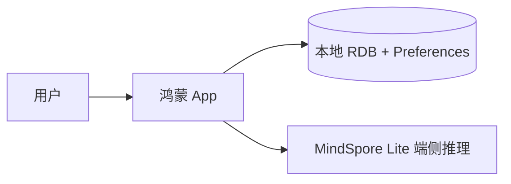
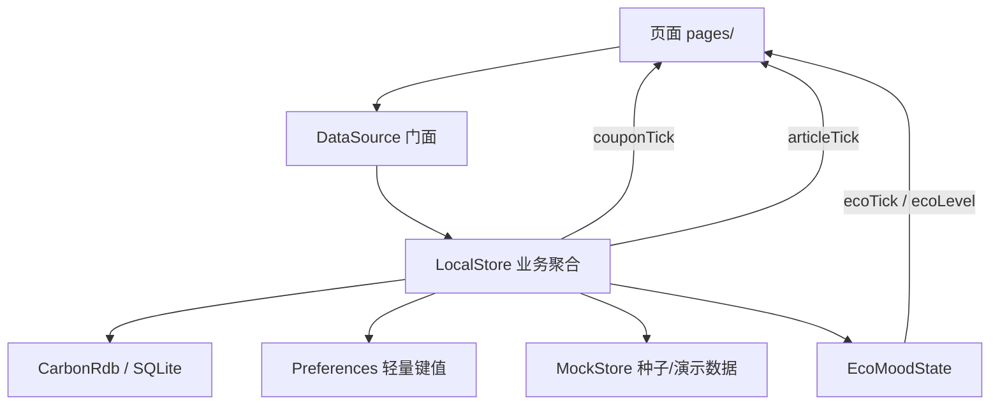

# 一触青绿 · 目录与代码索引（详细版）

> 配套文档：[`项目目录结构分析.md`](./项目目录结构分析.md)（入门版）。  
> 比赛答辩用的 8 分钟逐字稿与问答卡见 [`答辩逐字稿-8分钟.md`](./答辩逐字稿-8分钟.md)。  
> 本文是“详细索引”，重点回答：**某个目录/文件/页面/方法/接口/数据表到底是干什么的，改需求时应该动哪里。**  
> 基线：2026-10-26 的 `carbon-master` 工作区。代码在持续修改，若与最新代码有差异，以源码为准。

---

## 目录

1. [仓库快照](#1-仓库快照)
2. [全量目录树](#2-全量目录树)
3. [App 鸿蒙端详解](#3-app-鸿蒙端详解)
4. [文档、脚本与业务手册](#4-文档脚本与业务手册)
5. [数据契约与当前风险](#5-数据契约与当前风险)
6. [常见任务 → 改哪些文件](#6-常见任务--改哪些文件)
7. [常见故障排查](#7-常见故障排查)
8. [术语表](#8-术语表)
9. [一页速查](#9-一页速查)

---

## 0. 快速导航

| 我想找什么 | 看本文哪一节 |
|---|---|
| 仓库有哪些顶层目录 | 第 2 章 |
| 鸿蒙端每个文件干什么 | 3.1～3.3 |
| 36 个页面/弹层分别是什么 | 3.3 |
| 路由名和页面怎么对应 | 3.4 |
| 页面为什么这样写、怎么加页面 | 3.5 |
| 颜色/玻璃/通用组件在哪 | 3.6 |
| 数据从页面到 SQLite 怎么走 | 3.7 |
| `DataSource` / `LocalStore` / `CarbonRdb` 有哪些方法 | 3.8～3.10 |
| 演示数据、因子、文章、AI 词库在哪 | 3.11 |
| 账号、深色模式、碳情绪怎么实现 | 3.12～3.13 |
| AI 识图怎么跑 | 3.14 |
| 备份、导出、家庭、超级终端怎么实现 | 3.15 |
| 改一个需求要动哪些文件 | 第 6 章 |
| 常见故障怎么排查 | 第 7 章 |

---

## 1. 仓库快照

### 1.1 规模

| 部分 | 文件数 | 代码行数 | 说明 |
|---|---:|---:|---|
| `app/` ArkTS | 60 个 `.ets` | 34,861 行 | 鸿蒙单机 App，主交付物 |
| `business-logic-guide/` | 1 个 HTML + JS/CSS | — | 零基础业务讲解手册 |
| `docs/` | 2 个 Markdown + 4 张 PNG | — | 当前技术方案与 UI 方案 |
| `tools/` | 13 个 Python/JS | — | 文档、图表、主题校验脚本 |

### 1.2 技术栈

| 层 | 技术 | 关键版本/事实 |
|---|---|---|
| App 语言 | ArkTS | 鸿蒙 TypeScript 方言 |
| App UI | ArkUI | 声明式 UI，`@Component` + `build()` |
| App 路由 | Navigation + NavPathStack | 不是 `@ohos.router` |
| App 本地库 | RDB（SQLite） | `carbon.db`，5 张表 |
| App 轻量存储 | Preferences | 文件 `yichu_qinglv` |
| App 端侧 AI | MindSpore Lite + MobileNetV2 | 模型 14MB，`rawfile/mobilenetv2.ms` |
| App 构建 | Hvigor | `compileSdkVersion 26.0.0`，`compatibleSdkVersion 24` |
| App 包管理 | ohpm | 运行时无第三方依赖，测试用 hypium |
| App 包名 | `com.example.yichuqinglv` | 发布前应改正式包名 |

### 1.3 运行结构



一句话：

- **App 完全本地运行**，不依赖任何服务端。
- 结构化数据进 RDB（SQLite），轻量状态进 Preferences，两者都在沙箱内。
- 早期的 server / admin / db 已从仓库移除，需要时从 git 历史取回。

---

## 2. 全量目录树

```text
carbon-master/
├── README.md
├── 移植说明与接口文档.md
├── 超级终端多设备同步方案.md
├── 项目目录结构分析.md              # 入门版目录说明
├── 项目目录与代码索引-详细版.md      # 本文
│
├── app/                             # 鸿蒙端
│   ├── AppScope/
│   │   ├── app.json5                # 包名、版本、图标、应用名
│   │   └── resources/base/          # 应用级 string / media
│   ├── entry/
│   │   ├── src/main/
│   │   │   ├── module.json5         # 模块、Ability、页面、权限
│   │   │   ├── ets/
│   │   │   │   ├── entryability/
│   │   │   │   │   └── EntryAbility.ets
│   │   │   │   ├── common/router/
│   │   │   │   │   ├── AppRouter.ets
│   │   │   │   │   └── PageMap.ets
│   │   │   │   ├── pages/
│   │   │   │   │   ├── Index.ets
│   │   │   │   │   ├── SplashPage.ets
│   │   │   │   │   ├── OnboardingPage.ets
│   │   │   │   │   ├── auth/LoginGate.ets
│   │   │   │   │   ├── dashboard/DashboardPage.ets
│   │   │   │   │   ├── record/RecordListPage.ets
│   │   │   │   │   ├── behavior/{BehaviorAddSheet,BehaviorDetailPage,FactorLibPage,AiRecognizePage}.ets
│   │   │   │   │   ├── chart/{TrendChartPage,CategoryAnalysisPage}.ets
│   │   │   │   │   ├── points/{PointsHomePage,PointsRecordPage,TaskCenterPage,PointsMallPage,BadgeWallPage,BadgeDetailSheet,CertificateListPage,CertificateDetailPage,CouponListPage,CouponRedeemPage}.ets
│   │   │   │   │   ├── article/{ArticleListPage,ArticleDetailPage,FavoriteListPage,QuizSheet,ArticleCat}.ets
│   │   │   │   │   ├── mine/{MinePage,LevelTreePage,ProfilePage}.ets
│   │   │   │   │   ├── settings/{SettingsPage,BackupManagePage,ExportReportPage,MonthBillPage,FamilyPage,AboutPage,EcoDebugSheet}.ets
│   │   │   │   │   ├── smart/SmartTipsPage.ets
│   │   │   │   │   └── terminal/SuperTerminalPage.ets
│   │   │   │   ├── ui/
│   │   │   │   │   ├── Theme.ets
│   │   │   │   │   ├── GlassLight.ets
│   │   │   │   │   ├── GlassSurface.ets
│   │   │   │   │   ├── GlassDialog.ets
│   │   │   │   │   ├── Components.ets
│   │   │   │   │   ├── AppleMotion.ets
│   │   │   │   │   ├── LazyList.ets
│   │   │   │   │   └── Toast.ets
│   │   │   │   ├── data/
│   │   │   │   │   ├── LocalStore.ets
│   │   │   │   │   ├── MockStore.ets
│   │   │   │   │   ├── AccountStore.ets
│   │   │   │   │   ├── ThemeMode.ets
│   │   │   │   │   ├── EcoMoodState.ets
│   │   │   │   │   ├── rdb/CarbonRdb.ets
│   │   │   │   │   └── ai/AiVisionRecognizer.ets
│   │   │   │   ├── net/
│   │   │   │   │   └── DataSource.ets
│   │   │   │   └── utils/
│   │   │   │       ├── AppClock.ets
│   │   │   │       └── Clipboard.ets
│   │   │   └── resources/
│   │   │       ├── base/element/     # color.json / string.json
│   │   │       ├── base/media/       # app_icon.png
│   │   │       ├── base/profile/     # main_pages.json
│   │   │       ├── zh_CN/element/    # 多语言（基本为空）
│   │   │       ├── en_US/element/    # 多语言（基本为空）
│   │   │       └── rawfile/mobilenetv2.ms
│   │   ├── build/                    # 构建产物（HAP）
│   │   ├── .preview/                 # 预览器缓存
│   │   ├── build-profile.json5
│   │   ├── hvigorfile.ts
│   │   ├── obfuscation-rules.txt
│   │   └── oh-package.json5
│   ├── build-profile.json5           # 产品/签名/SDK
│   ├── hvigor/                       # Hvigor 配置
│   ├── hvigorfile.ts
│   ├── oh-package.json5
│   ├── oh-package-lock.json5
│   ├── oh_modules/                   # ohpm 依赖
│   ├── signature/                    # 签名材料（敏感）
│   ├── local.properties              # 本机 SDK 路径（不提交）
│   ├── build-check.ps1               # Windows 构建脚本
│   └── build-log*.txt                # 旧构建日志
│
├── docs/
│   ├── 一触青绿_OpenHarmony单机版技术方案_两套.md
│   ├── 液态玻璃与深色模式方案.md
│   └── assets/                       # fig1~fig4 PNG
│
├── tools/
│   ├── gen_docs.py
│   ├── gen_tech_doc.py
│   ├── gen_design_doc.py
│   ├── gen_design_doc_v2.py
│   ├── gen_diagrams.py
│   ├── gen_docx_figs.py
│   ├── gen_work_docx.py
│   ├── gen_ui_talk.py
│   ├── theme_dep_wrap.py
│   ├── theme_verify.py
│   ├── verify_doc.py
│   ├── strip-unused-imports.js
│   ├── swap_hero_colors.py
│   └── diagrams/                     # fig1~fig6 PNG
│
├── business-logic-guide/
│   ├── business-logic-guide.html
│   ├── assets/charts.js
│   └── _shared/js/                   # echarts / mermaid
│
├── .workbuddy/                       # AI 助手记忆/临时文件
├── .hvigor/                          # 构建缓存
├── .idea/                            # IDE 配置
├── node_modules/                     # 根 Node 依赖（文档工具）
└── .gitignore
```

---

## 3. `app/` 鸿蒙端详解

### 3.1 工程配置

| 配置 | 文件 | 当前值/说明 |
|---|---|---|
| 应用包名 | `AppScope/app.json5` | `com.example.yichuqinglv` |
| 版本 | `AppScope/app.json5` | `versionCode=1000000`，`versionName=1.0.0` |
| 应用图标/名称 | `AppScope/resources/` | `$media:app_icon` / `$string:app_name` |
| 编译 SDK | `build-profile.json5` | `compileSdkVersion='26.0.0'` |
| 兼容 SDK | `build-profile.json5` | `compatibleSdkVersion=24` |
| 目标 SDK | `build-profile.json5` | `targetSdkVersion='26.0.0'` |
| 运行时 | `build-profile.json5` | `runtimeOS='OpenHarmony'` |
| 设备类型 | `entry/src/main/module.json5` | `default`、`tablet` |
| 入口 Ability | `entry/src/main/module.json5` | `EntryAbility` |
| 页面清单 | `entry/src/main/resources/base/profile/main_pages.json` | 只有 `pages/Index` |
| 深色模式声明 | `module.json5` | `ohos.extension.colorMode = auto` |
| 权限 | `module.json5` | INTERNET、GET_NETWORK_INFO、DISTRIBUTED_DATASYNC（当前代码未使用） |
| 签名 | `build-profile.json5` + `signature/` | 含明文签名密码，**不要公开** |
| 本机 SDK | `app/local.properties` | `sdk.dir=D:/anzhi/SDK` |
| 运行时依赖 | `app/oh-package.json5` | 无第三方运行时依赖 |
| 测试依赖 | `app/oh-package.json5` | `@ohos/hypium 1.0.18` |
| AI 模型 | `resources/rawfile/mobilenetv2.ms` | 14MB，MobileNetV2 |
| 构建产物 | `entry/build/default/outputs/default/` | `entry-default-signed.hap` 约 18MB |

### 3.2 非页面源码索引（23 个文件）

| 文件 | 行数 | 作用 |
|---|---:|---|
| `entryability/EntryAbility.ets` | 142 | UIAbility 生命周期、窗口、启动链、系统栏反色 |
| `common/router/AppRouter.ets` | 43 | 全局 `NavPathStack` + 26 个路由名常量 |
| `common/router/PageMap.ets` | 140 | 路由名 → 页面组件注册；`go/goWithParam` |
| `ui/Theme.ets` | 1,273 | 颜色令牌、深色换血、碳情绪色、`Biz` 业务常量 |
| `ui/GlassLight.ets` | 1,303 | 液态玻璃光照模型、材质参数、视差 |
| `ui/GlassSurface.ets` | 403 | 玻璃表面组件（pill/card/panel） |
| `ui/GlassDialog.ets` | 955 | 玻璃弹窗/确认框 |
| `ui/Components.ets` | 1,446 | 通用按钮、卡片、胶囊、进度条、空状态等 |
| `ui/AppleMotion.ets` | 229 | 动画曲线与时长 |
| `ui/LazyList.ets` | 63 | 懒加载列表 |
| `ui/Toast.ets` | 118 | 轻提示/确认框 |
| `ui/Icon.ets` | 112 | `CfIcon`：语义 code → 图标资源，`colorFilter` 统一染色 |
| `common/icons/IconMap.ets` | 242 | 图标映射表：factor/category/task/badge/benefit/article/level/tip/ui |
| `data/LocalStore.ets` | 1,477 | **业务数据唯一入口**：记录、积分、券、任务、文章、备份 |
| `data/MockStore.ets` | 990 | 27 因子、30 天演示记录、8 权益、10 文章、4 设备、AI 词库 |
| `data/AccountStore.ets` | 396 | 账号注册/登录/会话/资料/多账号隔离 |
| `data/ThemeMode.ets` | 431 | 深色模式读盘、跟随系统、手动锁定、系统栏反色 |
| `data/EcoMoodState.ets` | 240 | 碳情绪四档、`ecoTick` 广播、当日减排判档 |
| `data/rdb/CarbonRdb.ets` | 1,023 | SQLite 封装：5 表、索引、聚合、分页、事务 |
| `data/ai/AiVisionRecognizer.ets` | 609 | 端侧 MobileNetV2 推理、ImageNet 类别映射 |
| `net/DataSource.ets` | 271 | 页面统一数据门面（纯本地，无 HTTP） |
| `utils/AppClock.ets` | 86 | 统一“今天/本月/日期字符串”口径 |
| `utils/Clipboard.ets` | 40 | 复制分享文案 |

### 3.3 页面/弹层总表（39 个文件）

> `P00-P35` 是项目内部页面编号；`A01-A03` 是辅助文件，不是独立页面。

| 编号 | 文件 | 行数 | 类型/入口 | 作用 |
|---|---|---:|---|---|
| P00 | `pages/Index.ets` | 1,648 | 唯一 `@Entry` | 主框架：Navigation + 四个 Tab + 底部胶囊 + 登录闸门 + 启动/引导覆盖 |
| P01 | `pages/SplashPage.ets` | 139 | `Index` 条件渲染 | 启动页品牌动画，不占路由 |
| P02 | `pages/OnboardingPage.ets` | 267 | `Index` 条件渲染 | 首次启动功能引导 |
| P03 | `pages/dashboard/DashboardPage.ets` | 979 | Tab1 | 首页看板：今日/本月/累计、碳情绪、任务卡、最近记录 |
| P04 | `pages/record/RecordListPage.ets` | 987 | Tab2 | 低碳记录列表：分类筛选、分页、汇总、删除 |
| P05 | `pages/article/ArticleListPage.ets` | 957 | Tab3 | 双碳科普专栏：分类、置顶、列表 |
| P06 | `pages/mine/MinePage.ets` | 747 | Tab4 | 我的：资料、积分、券包、徽章、设置入口 |
| P07 | `pages/behavior/BehaviorAddSheet.ets` | 518 | `bindSheet` 半模态 | 行为录入：选因子、填数量、提交 |
| P08 | `pages/behavior/BehaviorDetailPage.ets` | 590 | `BehaviorDetail` | 单条记录详情、删除/回退积分 |
| P09 | `pages/behavior/FactorLibPage.ets` | 404 | `FactorLib` | 27 项碳排放因子库 |
| P10 | `pages/chart/TrendChartPage.ets` | 1,468 | `TrendChart` | 减排趋势：日/周/月/年 |
| P11 | `pages/chart/CategoryAnalysisPage.ets` | 611 | `CategoryAnalysis` | 四大类占比分析 |
| P12 | `pages/mine/LevelTreePage.ets` | 482 | `LevelTree` | 成长树/等级（碳芽→森林卫士） |
| P13 | `pages/points/PointsHomePage.ets` | 572 | `PointsHome` | 积分首页：余额、任务、商城、记录入口 |
| P14 | `pages/points/PointsRecordPage.ets` | 583 | `PointsRecord` | 积分流水 |
| P15 | `pages/points/TaskCenterPage.ets` | 514 | `TaskCenter` | 每日任务列表、领取奖励 |
| P16 | `pages/points/PointsMallPage.ets` | 700 | `PointsMall` | 碳惠权益兑换（8 项） |
| P17 | `pages/points/BadgeWallPage.ets` | 592 | `BadgeWall` | 徽章墙（10 枚） |
| P18 | `pages/points/BadgeDetailSheet.ets` | 469 | `bindSheet` 半模态 | 徽章详情 |
| P19 | `pages/points/CertificateListPage.ets` | 487 | `CertificateList` | 植树证书夹 |
| P20 | `pages/points/CertificateDetailPage.ets` | 477 | `CertificateDetail` | 电子证书详情 |
| P21 | `pages/article/ArticleDetailPage.ets` | 542 | `ArticleDetail` | 文章详情、点赞/收藏、唤起测验 |
| P22 | `pages/article/FavoriteListPage.ets` | 399 | `FavoriteList` | 我的收藏 |
| P23 | `pages/article/QuizSheet.ets` | 472 | `bindSheet` 半模态 | 低碳小测验 |
| P24 | `pages/settings/SettingsPage.ets` | 767 | `Settings` | 设置：主题、备份、导出、家庭、关于 |
| P25 | `pages/settings/BackupManagePage.ets` | 491 | `BackupManage` | 数据备份/恢复（单机版） |
| P26 | `pages/settings/ExportReportPage.ets` | 638 | `ExportReport` | 报表导出：日报/月报 PNG + CSV 演示 |
| P27 | `pages/behavior/AiRecognizePage.ets` | 1,059 | `AiRecognize` | AI 拍照识别录入 |
| P28 | `pages/settings/MonthBillPage.ets` | 699 | `MonthBill` | 月度绿色账单 |
| P29 | `pages/settings/FamilyPage.ets` | 501 | `Family` | 家庭碳账户、成员排行 |
| P30 | `pages/settings/AboutPage.ets` | 430 | `About` | 关于、版本、隐私说明 |
| P31 | `pages/smart/SmartTipsPage.ets` | 310 | `SmartTips` | 智慧服务建议中心 |
| P32 | `pages/terminal/SuperTerminalPage.ets` | 453 | `SuperTerminal` | 超级终端：设备编组/家庭合并 |
| P33 | `pages/mine/ProfilePage.ets` | 578 | `Profile` | 个人资料：头像/名字/性别/手机号 |
| P34 | `pages/points/CouponListPage.ets` | 491 | `CouponList` | 碳惠券包 |
| P35 | `pages/points/CouponRedeemPage.ets` | 359 | `CouponRedeem` | 核销成功凭证页 + 二维码 |
| A01 | `pages/article/ArticleCat.ets` | 55 | 工具模块 | 文章分类元信息 + 阅读数格式化 |
| A02 | `pages/auth/LoginGate.ets` | 352 | `Index` 条件渲染 | 登录/注册闸门，不占路由 |
| A03 | `pages/settings/EcoDebugSheet.ets` | 396 | 设置页隐藏调试面板 | 强制切换碳情绪档位 |

### 3.4 路由表（26 个进栈页面）

| 路由常量 | 字符串 | 页面 | 文件 |
|---|---|---|---|
| `BEHAVIOR_DETAIL` | `BehaviorDetail` | P08 | `behavior/BehaviorDetailPage.ets` |
| `FACTOR_LIB` | `FactorLib` | P09 | `behavior/FactorLibPage.ets` |
| `AI_RECOGNIZE` | `AiRecognize` | P27 | `behavior/AiRecognizePage.ets` |
| `TREND_CHART` | `TrendChart` | P10 | `chart/TrendChartPage.ets` |
| `CATEGORY_ANALYSIS` | `CategoryAnalysis` | P11 | `chart/CategoryAnalysisPage.ets` |
| `LEVEL_TREE` | `LevelTree` | P12 | `mine/LevelTreePage.ets` |
| `POINTS_HOME` | `PointsHome` | P13 | `points/PointsHomePage.ets` |
| `POINTS_RECORD` | `PointsRecord` | P14 | `points/PointsRecordPage.ets` |
| `TASK_CENTER` | `TaskCenter` | P15 | `points/TaskCenterPage.ets` |
| `POINTS_MALL` | `PointsMall` | P16 | `points/PointsMallPage.ets` |
| `BADGE_WALL` | `BadgeWall` | P17 | `points/BadgeWallPage.ets` |
| `CERTIFICATE_LIST` | `CertificateList` | P19 | `points/CertificateListPage.ets` |
| `CERTIFICATE_DETAIL` | `CertificateDetail` | P20 | `points/CertificateDetailPage.ets` |
| `ARTICLE_DETAIL` | `ArticleDetail` | P21 | `article/ArticleDetailPage.ets` |
| `FAVORITE_LIST` | `FavoriteList` | P22 | `article/FavoriteListPage.ets` |
| `SETTINGS` | `Settings` | P24 | `settings/SettingsPage.ets` |
| `BACKUP_MANAGE` | `BackupManage` | P25 | `settings/BackupManagePage.ets` |
| `EXPORT_REPORT` | `ExportReport` | P26 | `settings/ExportReportPage.ets` |
| `MONTH_BILL` | `MonthBill` | P28 | `settings/MonthBillPage.ets` |
| `FAMILY` | `Family` | P29 | `settings/FamilyPage.ets` |
| `ABOUT` | `About` | P30 | `settings/AboutPage.ets` |
| `SMART_TIPS` | `SmartTips` | P31 | `smart/SmartTipsPage.ets` |
| `SUPER_TERMINAL` | `SuperTerminal` | P32 | `terminal/SuperTerminalPage.ets` |
| `PROFILE` | `Profile` | P33 | `mine/ProfilePage.ets` |
| `COUPON_LIST` | `CouponList` | P34 | `points/CouponListPage.ets` |
| `COUPON_REDEEM` | `CouponRedeem` | P35 | `points/CouponRedeemPage.ets` |

> Tab 页（P03-P06）、启动/引导（P01/P02）、登录闸门（A02）不进入路由栈。  
> P07/P18/P23 是 `bindSheet` 半模态，不是 `NavDestination`。

### 3.5 页面写法与新增页面

典型页面结构：

```ts
@Component
export struct XxxPage {
  @State items: LocalXxx[] = []

  aboutToAppear(): void {
    this.load()
  }

  private async load(): Promise<void> {
    this.items = await DataSource.xxx()
  }

  build() {
    NavDestination() {
      // 页面内容
    }
    .title('页面标题')
  }
}
```

新增一个进栈页面要改 3 处：

1. `pages/` 下新建页面文件，`build()` 里包 `NavDestination`。
2. `common/router/AppRouter.ets`：加 `RouteName.XXX` 常量。
3. `common/router/PageMap.ets`：import 页面 + 在 `PageMap(name)` 里加分支。

如果是 Tab 页，则改 `Index.ets` 的 Tab 内容和底部导航，不进 `PageMap`。

参数传递注意：

```ts
// PageMap.ets
export function goWithParam(route: string, paramKey: string, paramValue: number): void {
  AppStorage.setOrCreate<number>(paramKey, paramValue)
  go(route)
}
```

- 必须用 `setOrCreate`，不能用 `set`。`set` 对不存在的键是静默 no-op，目标页会读到 `undefined`。
- 目标页 `aboutToAppear()` 读取后应 `AppStorage.delete(paramKey)`，避免下一次进入读到旧值。
- 常见参数键：`detailRecordId`、`detailArticleId`、`detailCertId`、`detailMonth`、`presetCategory`、`presetItemId`、`redeemCouponId`。

### 3.6 UI 设计系统

| 文件 | 行数 | 作用 |
|---|---:|---|
| `Theme.ets` | 1,273 | 颜色令牌、字体、圆角、间距、`ThemePalette` 明暗换血、`EcoTheme` 碳情绪色、`Biz` 业务常量 |
| `GlassLight.ets` | 1,303 | 液态玻璃：135° 主光源、菲涅尔描边、材质档位、滚动视差、画质降级 |
| `GlassSurface.ets` | 403 | 玻璃表面容器：`PILL` / `CARD` / `PANEL` |
| `GlassDialog.ets` | 955 | 玻璃弹窗、确认框、底部菜单 |
| `Components.ets` | 1,446 | `CfCard`、`CfButton`、`CfPill`、`CfSection`、`CfEmpty`、进度条等 |
| `AppleMotion.ets` | 229 | 动画曲线/时长常量 |
| `LazyList.ets` | 63 | 懒加载列表封装 |
| `Toast.ets` | 118 | `toast()` / `Toast.confirmWith()` |

关键规则：

- **不要硬编码颜色**。优先用 `Brand`、`Neutral`、`Accent`、`EcoTheme`。
- 静态颜色令牌不是响应式的。页面/组件里读取静态色值时，要用项目里的 `tc()` 包裹，建立 `themeTick` 依赖，否则切深色后当前页不换色。
- 玻璃模糊每层都有离屏渲染成本。同一区域不要叠多层 `backdropBlur`；滑动中的卡片要克制缩放。
- 碳情绪四档：`none`（<1kg）、`warn`（<3kg）、`good`（<5kg）、`eco`（≥5kg），由 `EcoTheme.level(todayKg, quota)` 计算。

#### 3.6.1 图标系统（Tabler 线稿 + 卡通插画）

**一条规则**：需要跟随主题变色的“结构与操作”用线稿；本身就是内容的“情绪与身份”用卡通。

| 层 | 位置 | 职责 |
|---|---|---|
| 图标源 | `tabler-icons-main/`（仓库外，开发机） | Tabler 原始 SVG |
| 同步 | `app/scripts/sync-icons.sh` | 挑图标 → 剥注释 → `currentColor` 烘成 `#FFFFFF` → 写 `resources/base/media/ic_*.svg` |
| 映射 | `common/icons/IconMap.ets` | 语义 code（`'home'`、`'walk'`、`'badge_guardian'`）→ `$r('app.media.ic_*')`，缺失回落 `ic_target` |
| 渲染 | `ui/Icon.ets` → `CfIcon` | 统一尺寸、`@StorageProp('themeTick')` 主题重建、`colorFilter` 染色 |
| 资源 | `resources/base/media/ic_*.svg` | 95 个白色描边图标（不要直接 `Image()` 引用，浅色底会看不见） |

**为什么用颜色矩阵染色**：Tabler 是 `stroke="currentColor"` 的描边图，`fillColor` 只改 `fill`，`renderMode(Template)` 对这类图也不生效（实测仍是黑色）。同步脚本先把描边烘成纯白，`CfIcon` 再用 4×5 矩阵按通道相乘（白色 × 目标色 = 目标色），alpha 原样透传。详见 `ui/Icon.ets` 头注释。

**线稿 / 卡通的分工**：

| 用线稿（`CfIcon`） | 用卡通（emoji / 原画） |
|---|---|
| 底部导航、宫格、列表行、按钮、统计卡、表单、筛选 chip、元信息、状态提示 | 用户头像、徽章墙的成就原画、看板植物等级（`Biz.levelArt`）、空态插画、答题满分庆祝 |

**两个例外**：

- 空态默认走卡通插画（`CfEmpty` 的 `EMPTY_ART` 表），但**指引型空态**（AI 识图、证书夹）加 `line: true` 改用线稿——这类空态的重点是"下一步做什么"，卡通会把注意力从行动按钮上引开。
- 看板的等级徽章用 `Biz.levelArt(level)` 的植物原画（🌱→🌿→🍀→🌳→🌲），与 `Biz.levelName` 一一对应；同页的"成长树"入口仍是线稿（它是导航，不是情绪）。

**加一个新图标**：

1. 在 `app/scripts/sync-icons.sh` 的图标列表里加上 Tabler 名字（如 `battery-charging`）；
2. 跑 `./app/scripts/sync-icons.sh`，确认 `ic_battery_charging.svg` 落到 `base/media/`；
3. 在 `IconMap.ets` 对应表里加一条语义 code → `$r(...)`；
4. 页面里写 `CfIcon({ kind: 'ui', code: 'battery', iconSize: 18 })`，不要再写 `Text('🔋')`。

`Biz` 业务常量：

| 常量/方法 | 值/规则 |
|---|---|
| `POINTS_PER_KG` | 10 |
| `POINTS_PER_TREE` | 3000 |
| `levelOf(totalKg)` | <10 级1、<100 级2、<500 级3、<1000 级4、≥1000 级5 |
| `levelName(level)` | 碳芽、新芽、绿芽、低碳达人、森林卫士 |
| `pointsOf(kg)` | `max(1, round(kg*10))` |
| `treesOf(points)` | `floor(points/3000)` |
| `formatKg(kg)` | <10kg 两位小数、<1000kg 一位小数、≥1000kg 转 t |

### 3.7 数据层总览



调用顺序：

```text
页面 aboutToAppear()
  → DataSource.xxx()
  → LocalStore.init()（幂等）
  → CarbonRdb / Preferences
  → 返回 LocalXxx 结构
  → 页面 @State 赋值 → build() 刷新
```

写入顺序：

```text
用户提交
  → DataSource.addRecord(...)
  → LocalStore.addRecord(...)
  → CarbonRdb.insertRecord(...)
  → LocalStore.addBalance(points)
  → EcoMoodState.broadcastDataChange()（ecoTick++）
  → 订阅页面 @Watch 重拉数据
```

#### AppStorage 关键键

| 键 | 类型 | 作用 |
|---|---|---|
| `appContext` | `common.Context` | 数据层拿 Preferences/RDB 的应用上下文 |
| `sessionUser` | string | 当前登录账号；空 = 未登录 |
| `sessionReady` | boolean | 账号读盘完成，防止首帧闪错屏 |
| `profileTick` | number | 个人资料变更信号 |
| `ecoTick` | number | 记录变更信号，页面重算/重拉 |
| `ecoLevel` | string | 当前碳情绪档位 `none/warn/good/eco` |
| `ecoToday` | number | 今日减排量 kg |
| `ecoOverride` | string | 调试强制档位，空 = 自动 |
| `themeTick` | number | 深色模式换血信号 |
| `darkMode` | boolean | 当前是否深色 |
| `couponTick` | number | 券变更信号（兑换/核销/切账号） |
| `articleTick` | number | 文章点赞/收藏变更信号 |
| `activeTab` | number | 当前 Tab |
| `showAddSheet` | boolean | 行为录入面板开关 |
| `hideFab` | boolean | 是否隐藏悬浮按钮 |
| `detailRecordId` 等 | number/string | 路由参数，目标页读完删除 |

### 3.8 `DataSource` API（24 个）

> `net/DataSource.ets` 名字叫 net，但**没有任何 HTTP 请求**。它是页面统一调用的本地门面。

| 方法 | 返回 | 用途 |
|---|---|---|
| `ready()` | `Promise<void>` | 确保 LocalStore 初始化 |
| `overview()` | `LocalOverview` | 首页总览（今日/本月/累计/积分/连续天数） |
| `trend(granularity)` | `TrendPoint[]` | 趋势：`day/week/month/year` |
| `categoryStats(days)` | `LocalRecord[]` | 四大类统计（用 record 结构承载聚合） |
| `factors()` | `LocalFactor[]` | 27 项行为因子 |
| `records()` | `LocalRecord[]` | 全部记录 |
| `recordsOf(category)` | `LocalRecord[]` | 按分类取记录 |
| `recordsPage(category, offset, limit)` | `LocalRecord[]` | 分页记录 |
| `recordsSummary(category)` | `RecordSummary` | 分类汇总（条数/减排/积分） |
| `tasks()` | `LocalTask[]` | 今日任务 + 进度 + 领取态 |
| `badges()` | `LocalBadge[]` | 10 枚徽章 + 解锁态 |
| `pointsLogs()` | `LocalPointsLog[]` | 积分流水 |
| `certificates()` | `LocalCert[]` | 植树证书 |
| `benefits()` | `LocalBenefit[]` | 8 项碳惠权益 |
| `coupons()` | `LocalCoupon[]` | 券包 |
| `articles()` | `LocalArticle[]` | 10 篇科普文章 + 互动态 |
| `focusTask()` | `LocalFocusTask` | 今日重点任务 |
| `smartTips()` | `LocalSmartTip[]` | 智慧建议 |
| `devices()` | `LocalDevice[]` | 超级终端设备 |
| `familyMembers()` | `LocalMember[]` | 家庭成员 |
| `addRecord(...)` | `LocalRecord` | 写入记录 + 积分 + 广播 |
| `removeRecord(recordId)` | `boolean` | 删除记录 + 回退积分 |
| `recognize(imageUri)` | `LocalRecord \| undefined` | AI 识别 → 预填记录 |
| `shareText()` | `string` | 生成分享文案 |

### 3.9 `LocalStore` 方法索引

> `LocalStore` 是 App 业务数据的唯一入口。页面不直接调 `CarbonRdb`，都经过它。

| 分组 | 方法 | 说明 |
|---|---|---|
| 生命周期 | `init()` | 打开 RDB、迁移旧 Preferences、按会话切换命名空间、灌种子 |
| 账号 | `switchUser(user)` | 切换当前账号的数据空间 |
| 记录 | `allRecords()` / `recordsOf()` / `recordsPage()` / `recordById()` | 读取记录 |
| 记录 | `recordsSummary(category)` | 分类汇总 |
| 记录 | `addRecord(...)` | 写记录、算积分、加余额、广播 |
| 记录 | `removeRecord(recordId)` | 删记录、扣回积分、广播 |
| 记录 | `stats()` | 首页/看板聚合：今日、本月、累计、积分、连续天数、徽章数 |
| 备份 | `backup()` | 记录 + 券写入 `backup_slot`，份数 +1 |
| 备份 | `restore()` | 用备份覆盖当前记录/券，余额重算 |
| 备份 | `lastBackupTime()` / `backupCount()` | 备份时间/份数 |
| 数据 | `hasData()` / `clear()` / `restoreDemo()` | 是否有数据、清空、恢复演示数据 |
| 任务 | `taskClaimed(code)` / `claimedTaskCodesToday()` | 今日是否已领 |
| 任务 | `claimTask(code, points)` | 落库 + 加余额，幂等 |
| 任务 | `taskPointsToday()` | 今日任务奖励合计 |
| 券 | `allCoupons()` / `couponById()` / `couponStatus()` / `availableCouponCount()` | 券查询/状态 |
| 券 | `exchange(benefit)` | 扣积分 → 生成券 → 落库 |
| 券 | `useCoupon(couponId)` | 核销 → 生成二维码内容 |
| 券 | `ensureQrContent(couponId)` | 旧券二维码格式补生成 |
| 券 | `bumpCouponTick()` | 券变更广播 |
| 文章 | `articleState()` / `setArticleState()` / `applyArticleInteract()` | 点赞/收藏状态 |
| 同步遗留 | `mergeRemote()` / `removeByClientId()` / `allForSync()` | 跨设备同步代码，当前无调用方 |

内部关键私有方法（理解口径用）：

- `computeLegacyBalance()`：`max(0, 记录积分合计 + 今日任务奖励 - 券积分合计)`，用于旧数据迁移/恢复后重算。
- `addBalance()/subBalance()`：余额持久化，负值抹平。
- `syncEcoMood()`：记录变化后刷新碳情绪。
- `keyFor(key)`：按账号拼 Preferences 键，实现多账号隔离。

### 3.10 `CarbonRdb` 表与方法

数据库文件：`carbon.db`，`encrypt: false`，按 `user_key` 行级隔离。

| 表 | 用途 | 关键字段 |
|---|---|---|
| `carbon_record` | 行为记录 | `record_id`、`item_code`、`category`、`amount`、`reduce_kg`、`points`、`behavior_time`、`client_record_id` |
| `carbon_coupon` | 兑换券 | `coupon_id`、`benefit_code`、`points`、`kind`、`issued_at`、`expire_at`、`status`、`qr_content` |
| `task_claim` | 任务领取 | `task_code`、`date_str`、`points` |
| `article_interact` | 文章互动 | `article_id`、`liked`、`faved`、`like_delta` |
| `backup_slot` | 备份快照 | `user_key`、`payload`、`saved_at` |

方法分组：

| 分组 | 方法 |
|---|---|
| 初始化 | `open(ctx)` |
| 记录写 | `insertRecord`、`insertRecords`、`updateRecord`、`deleteRecord`、`deleteByClientId`、`replaceRecords` |
| 记录读 | `allRecords`、`recordsOf`、`recordById`、`findByClientId`、`recordsPage` |
| 聚合 | `statsAgg`、`summaryAgg`、`distinctDates`、`countRecords`、`maxRecordId` |
| 券 | `allCoupons`、`insertCoupon`、`updateCoupon`、`replaceCoupons` |
| 任务 | `allClaims`、`insertClaim`、`replaceClaims` |
| 文章 | `articleMap`、`upsertArticle`、`replaceArticle` |
| 备份 | `saveBackup`、`loadBackup` |
| 账号 | `clearUser`、`replaceUserData` |

设计要点：

- 记录表是唯一会无上限增长的表，统计尽量用 SQL 聚合下推（`statsAgg`/`summaryAgg`），避免把全部记录捞到内存。
- 分页用 `LIMIT/OFFSET`，按 `behavior_time` 倒序。
- `client_record_id` 是唯一键，用于导入/同步去重。
- 恢复用事务：记录 + 券要么整体成功，要么整体回滚。
- **没有 schema version 升级机制**：以后改表结构要自己写迁移，不能只改 `CREATE TABLE`。

### 3.11 `MockStore` 种子与演示数据

| 数据 | 数量 | 说明 |
|---|---:|---|
| 行为因子 | 27 | travel 6、energy 6、recycle 8、food 7 |
| 演示记录 | 近 30 天 | 确定性哈希生成，单日约 0.1~5kg |
| 碳惠权益 | 8 | b1~b8，b7 公益植树 3000 分 |
| 科普文章 | 10 | policy/concept/tips 三类 |
| 超级终端设备 | 4 | 手机、平板、手表、电视 |
| 家庭成员 | 若干 | 用于家庭账户排行 |
| AI 关键词对 | 35 组 | `KEYWORD_PAIRS`，与 DB 的 54 条关键词是两套数据 |
| 分享文案 | 1 | 根据真实 `LocalStats` 生成 |

> `MockStore` 不是“仅后端未启动时的兜底”，它现在是 App 的种子数据/演示数据来源之一，和 `LocalStore` 一起工作。

### 3.12 `AccountStore`

- Preferences 文件与 `LocalStore` 相同：`yichu_qinglv`。
- 键：
  - `acct_list`：账号注册表 JSON
  - `acct_session`：上次登录账号
  - `acct_profile:<user>`：每个账号的资料
- 内置开发者账号：用户名 `1`，密码 `12345678any`。
- 密码：盐 + FNV/xorshift 混淆哈希，32 位，**不是加密学安全哈希**，只用于单机演示防肉眼翻库。
- 注册规则：用户名 trim 后非空、不含空格、≤20 字符；密码至少 8 位、仅字母数字、必须同时含字母和数字。
- 多账号隔离：
  - 登录/注册成功 → `setSession` → `LocalStore.switchUser(user)`。
  - RDB 记录按 `user_key` 隔离；Preferences 键按账号加前缀。
  - 注销/切换 → 登录闸门整树重建 → 各页 `aboutToAppear` 重跑。
- 开发者账号的数据空间保留完整演示数据；普通注册账号从空数据开始。

### 3.13 深色模式与碳情绪

#### `ThemeMode`

- 持久化键：`dark_mode`（是否深色）、`dark_mode_lock`（是否用户手动锁定）、`glass_quality`（玻璃画质）。
- 默认跟随系统；用户在设置页手动切换后锁定。
- 切换时写 `AppStorage['darkMode']` + `themeTick++`，页面重建读取新色值。
- 系统栏图标反色由 `ThemeMode.applySystemBar()` 负责。

#### `EcoMoodState`

- 日预算 `QUOTA = 5 kg`。
- 判档：
  - `< 1 kg` → `none`（灰，静默）
  - `< 3 kg` → `warn`（暖黄，升温）
  - `< 5 kg` → `good`（黄绿，渐入佳境）
  - `≥ 5 kg` → `eco`（荧光绿，目标达成）
- 记录变化 → `ecoTick++` → 订阅页面重算。
- 调试面板可写 `ecoOverride` 强制档位，`''` 恢复自动。
- 注销/切账号要 `resetForAccount()`，否则会停留在上一个账号的颜色。

### 3.14 AI 识图流程

```text
AiRecognizePage 选图/拍照
  → AiVisionRecognizer.pickPhoto()
  → ensureModel()：从 rawfile 读 mobilenetv2.ms，创建 MindSpore Lite 实例
  → decodeForModel()：解码图片，最长边 640，模型输入 224×224
  → preprocessAsync()：归一化（mean/std）
  → infer()：model.predict()
  → softmax() + aggregate()：ImageNet 类别 → 低碳因子 code
  → recognize()：返回因子、置信度、匹配标签
  → 页面预填 BehaviorAddSheet
```

关键参数：

- 模型：MobileNetV2，输入 224×224，输出约 1001 维。
- 类别映射：28 个 ImageNet 类别 → 11 个低碳因子（bike/bus/plastic/bag/glass/paper_waste/classify/clearplate/elec/cup/veggie）。
- 置信度阈值：`MIN_CONFIDENCE = 0.05`；低于阈值/无命中时走演示词库兜底。
- 模型加载失败：记录 `brokenReason`，`usable()` 返回 false，页面提示不可用。
- 模型文件已内嵌 HAP，**不需要联网**。

### 3.15 备份、导出、家庭、超级终端

#### 备份（P25）

- 存储：RDB `backup_slot`，每个账号一份。
- 内容：记录 + 券（`BackupPayload { records, coupons }`）。
- 不包含：任务领取、文章互动、积分余额。
- 恢复：
  - 兼容 v1（纯记录数组）和 v2（记录+券对象）。
  - 事务覆盖记录和券。
  - 余额按恢复后的快照重算：`max(0, 记录积分合计 + 今日任务奖励 - 券积分合计)`。
- UI 的“已备份份数”是 Preferences 里的累计计数，但实际只有最近一份快照。

#### 导出（P26）

- 日报/月报：`componentSnapshot` 截图 → PNG → 写入应用沙箱 `export/`。
- CSV：演示反馈，不真实写文件。
- 预览器不支持截图，会提示在真机/模拟器使用。

#### 家庭（P29）

- 数据：`MockStore.membersFrom()` 演示成员 + `DataSource.familyMembers()`。
- 展示：家庭合计减排、合计积分、成员排行、在线设备数。
- 邀请：复制邀请文案到剪贴板。
- 当前是本地演示，没有真实家庭组网。

#### 超级终端（P32）

- 数据：`MockStore.devices()` 4 台设备。
- 展示：设备在线状态、今日减排、家庭成员排行。
- “同步”是本地模拟，不涉及分布式软总线/DISTRIBUTED_DATASYNC。
- 当前权限声明里有 `DISTRIBUTED_DATASYNC`，但代码未使用。

### 3.16 构建与运行

**方式一：DevEco Studio**

1. 打开 `app/` 目录（不是仓库根目录）。
2. 确认 SDK：compile 26.0.0，compatible 24。
3. 选择 `entry` 模块，设备选手机/平板/模拟器。
4. Run。

**方式二：Windows 命令行**

```powershell
cd app
powershell -File build-check.ps1
```

脚本内部：

```text
JAVA_HOME = D:\anzhi\DevEco Studio\jbr
node = D:\anzhi\DevEco Studio\tools\node
hvigorw = D:\anzhi\DevEco Studio\tools\hvigor\bin\hvigorw.js
assembleHap --no-daemon
```

产物：

```text
app/entry/build/default/outputs/default/entry-default-signed.hap
app/entry/build/default/outputs/default/entry-default-unsigned.hap
```

注意：

- `app/local.properties` 绑定 `D:/anzhi/SDK`；换机器要改。
- 当前 Linux 环境没有 DevEco/鸿蒙 SDK，不能直接构建 App。
- `signature/` 和 `build-profile.json5` 含签名材料，提交/分享前要脱敏。
- HAP 约 18MB，其中模型约 14MB。

---

## 4. 文档、脚本与业务手册

### 4.1 `docs/`

| 文件 | 内容 | 适合 |
|---|---|---|
| `docs/一触青绿_OpenHarmony单机版技术方案_两套.md` | 单机版两套方案，方案二 RDB 已落地 | 架构/数据层 |
| `docs/液态玻璃与深色模式方案.md` | 玻璃光照、深色换血、组件规范、性能红线 | UI/主题 |
| `docs/assets/fig1_architecture.png` | 架构图 | 文档/答辩 |
| `docs/assets/fig2_record_flow.png` | 记录流程图 | 文档/答辩 |
| `docs/assets/fig3_ai_flow.png` | AI 流程图 | 文档/答辩 |
| `docs/assets/fig4_modules.png` | 模块图 | 文档/答辩 |

根目录历史文档：

| 文件 | 说明 |
|---|---|
| `移植说明与接口文档.md` | 历史归档：早期“源项目 → 四端”移植记录，对应代码已删除 |
| `超级终端多设备同步方案.md` | 多设备同步设计，当前未启用 |

### 4.2 `tools/`

| 脚本 | 作用 | 备注 |
|---|---|---|
| `gen_docs.py` | 生成项目文档 | Python |
| `gen_tech_doc.py` | 生成双方案技术文档 | Python |
| `gen_design_doc.py` / `gen_design_doc_v2.py` | 生成设计方案 Word | `python-docx` / `matplotlib` |
| `gen_diagrams.py` | 生成架构/流程图 | `matplotlib` |
| `gen_docx_figs.py` | 生成 Word 插图 | `Pillow` |
| `gen_work_docx.py` | 生成工作文档 | `python-docx` |
| `gen_ui_talk.py` | 生成 UI 讲解材料 | Python |
| `theme_dep_wrap.py` | 主题依赖包装/批量改代码 | Python |
| `theme_verify.py` | 主题一致性校验 | Python |
| `verify_doc.py` | 文档校验 | Python |
| `strip-unused-imports.js` | 清理未使用 import | Node |
| `swap_hero_colors.py` | 替换主视觉颜色 | Python |
| `tools/diagrams/` | 生成好的 6 张图 | PNG |

注意：

- 多数脚本含 Windows 绝对路径（如 `D:\11\carbon-master\...`），换机器要改。
- 依赖 `python-docx`、`matplotlib`、`Pillow`。
- 这些脚本不是 App 运行时依赖。

### 4.3 `business-logic-guide/`

零基础业务讲解 HTML，章节：

1. 这个 App 是干什么的
2. 核心业务主线
3. 账是怎么算的（减排/积分/变色）
4. 页面地图
5. 数据存在哪
6. 三大亮点功能
7. 动手测试清单
8. 5 分钟讲稿 + 问答
9. 手册事实来源

直接浏览器打开 `business-logic-guide.html`。依赖本地 `_shared/js/echarts.min.js`、`mermaid.min.js`，不需要联网。

### 4.4 `.workbuddy/`

- `memory/`：AI 助手每日记忆、长期约定。
- `tmp/`：临时脚本、截图、校验输出。
- `crop_*.png`：UI 截图裁剪，用于像素级比对。
- 不是产品代码，不要从这里找业务逻辑。

---

## 5. 数据契约与当前风险

### 5.1 当前风险

| 项 | 现状 | 影响 |
|---|---|---|
| AI 关键词 | `MockStore.KEYWORD_PAIRS` 35 组，全部硬编码在端侧 | 新增因子要同步补词库 |
| 备份 | 只有 1 个 `backup_slot`，只含记录+券 | UI“份数”与实际不符；任务/文章/余额不在快照 |
| 权限 | 仍声明 INTERNET / GET_NETWORK_INFO / DISTRIBUTED_DATASYNC | 上架隐私说明与代码不符 |
| 同步字段 | `clientRecordId/updateTime/syncFlag` 和 `mergeRemote/removeByClientId/allForSync` 无调用方 | 死代码/理解成本 |
| 测试/CI | `ohosTest` 只有 `.gitkeep`；无 CI | 回归靠手点 |
| 换行符 | 工作区大量 CRLF/LF 差异 | `git status` 噪声大，真实改动约 47 文件 |
| RDB 迁移 | 无 schema version | 后续改表结构容易丢数据 |

---

## 6. 常见任务 → 改哪些文件

### 6.1 App 功能

| 需求 | 主要文件 | 还要注意 |
|---|---|---|
| 改首页看板 | `pages/dashboard/DashboardPage.ets` | `LocalStore.stats()`、`EcoMoodState` |
| 改记录列表 | `pages/record/RecordListPage.ets` | `DataSource.recordsPage/recordsSummary` |
| 加行为因子 | `data/MockStore.ets` 的 `factors()` | `CarbonRdb` 建表/迁移、`KEYWORD_PAIRS`、图标映射 |
| 改积分规则 | `ui/Theme.ets` 的 `Biz` | `LocalStore.addRecord/claimTask/exchange` |
| 改等级阈值 | `ui/Theme.ets` 的 `Biz.levelOf/levelName` | `pages/mine/LevelTreePage.ets` |
| 改碳情绪档位 | `data/EcoMoodState.ets` + `ui/Theme.ets` 的 `EcoTheme.level` | 调试面板 `EcoDebugSheet` |
| 改深色模式 | `data/ThemeMode.ets` + `ui/Theme.ets` | 页面里的静态色要 `tc()` 包裹 |
| 改玻璃效果 | `ui/GlassLight.ets` / `GlassSurface.ets` | 注意 blur 层数与性能 |
| 加页面 | `pages/` 新建 | `AppRouter.ets` + `PageMap.ets` |
| 加 Tab | `pages/Index.ets` | 底部导航/胶囊布局 |
| 改登录规则 | `data/AccountStore.ets` | `pages/auth/LoginGate.ets` |
| 改备份 | `data/LocalStore.ets` 的 `backup/restore` | `CarbonRdb.saveBackup/loadBackup`、`BackupManagePage` |
| 改导出 | `pages/settings/ExportReportPage.ets` | `componentSnapshot`、沙箱 `export/` |
| 改 AI 识别 | `data/ai/AiVisionRecognizer.ets` | 模型文件、`CLASS_MAP`、`AiRecognizePage` |
| 改家庭 | `pages/settings/FamilyPage.ets` | `MockStore.membersFrom`、`DataSource.familyMembers` |
| 改超级终端 | `pages/terminal/SuperTerminalPage.ets` | `MockStore.devices`、`DataSource.devices` |
| 改文章 | `data/MockStore.ets` 的 `articles()` | `pages/article/*` |
| 改任务 | `data/MockStore.ets` 的 `tasksFrom()` | `LocalStore.claimTask` |
| 改徽章 | `data/MockStore.ets` 的 `badgesBy()` | `pages/points/BadgeWallPage.ets` |
| 改券/核销 | `data/LocalStore.ets` 的 `exchange/useCoupon` | `CouponListPage`/`CouponRedeemPage` |
| 改分享文案 | `data/MockStore.ets` 的 `shareText()` | `utils/Clipboard.ets` |

### 6.2 文档/构建

| 需求 | 文件 |
|---|---|
| 改目录说明 | `项目目录结构分析.md` / 本文 |
| 改技术方案 | `docs/一触青绿_OpenHarmony单机版技术方案_两套.md` |
| 改 UI 方案 | `docs/液态玻璃与深色模式方案.md` |
| 重新生成 Word/图 | `tools/` |
| 改构建脚本 | `app/build-check.ps1` |
| 改签名/SDK | `app/build-profile.json5` / `app/local.properties` |
| 改包名/版本 | `app/AppScope/app.json5` |
| 改权限 | `app/entry/src/main/module.json5` |
| 改应用名/图标 | `app/AppScope/resources/` |
| 加/换业务图标 | `app/scripts/sync-icons.sh` + `common/icons/IconMap.ets` | 页面里的 `CfIcon({ kind, code })`；详见 3.6.1 |

---

## 7. 常见故障排查

| 现象 | 可能原因 | 排查 |
|---|---|---|
| App 构建失败 | SDK 路径不对 | 看 `app/local.properties` 是否指向本机 SDK |
| 构建失败 | 签名配置/证书不对 | 看 `build-profile.json5`、`signature/` |
| 构建失败 | API 版本不匹配 | compile 26.0.0，compatible 24 |
| 页面白屏 | 路由没注册 | `RouteName` + `PageMap` 是否都有 |
| 页面白屏 | 页面没包 `NavDestination` | 进栈页面 `build()` 必须返回 `NavDestination` |
| 路由参数 undefined | 用了 `AppStorage.set` | 改成 `setOrCreate` |
| 记录后首页不刷新 | 没广播 `ecoTick` | 写入后 `EcoMoodState.broadcastDataChange()` |
| 深色模式只变一页 | 静态色没订阅 `themeTick` | 用 `tc()` 包裹静态色读取 |
| 切账号颜色不变 | 没 `resetForAccount()` | 见 `EcoMoodState.resetForAccount` |
| 券包不刷新 | 没 `bumpCouponTick()` | 兑换/核销后调用 |
| 备份恢复为空 | 没有备份/内容为空 | 先 `backup()`，再 `restore()` |
| 恢复后余额不对 | 余额是重算的 | 口径：记录积分 + 今日任务 - 券积分 |
| AI 识别不可用 | 模型没加载/预览器不支持 | 真机/模拟器，检查 `rawfile/mobilenetv2.ms` |
| 预览器登录崩溃 | Preferences 不可用 | 代码已 try/catch；仍要看日志 |
| 记录重复 | `client_record_id` 冲突 | 唯一键会拦；检查导入去重 |

---

## 8. 术语表

| 术语 | 解释 |
|---|---|
| OpenHarmony | 开源鸿蒙操作系统 |
| ArkTS | 鸿蒙 TypeScript 方言 |
| ArkUI | 鸿蒙声明式 UI |
| UIAbility | 鸿蒙应用组件，管理生命周期/窗口 |
| HAP | Harmony Ability Package，鸿蒙安装包 |
| Hvigor | 鸿蒙构建工具 |
| ohpm | 鸿蒙包管理器 |
| RDB | 鸿蒙关系型数据库（SQLite） |
| Preferences | 鸿蒙轻量键值存储 |
| NavPathStack | Navigation 页面栈 |
| NavDestination | Navigation 子页面容器 |
| `@Entry` | 页面入口标记 |
| `@Component` | 自定义组件标记 |
| `@State` | 组件响应式状态 |
| `@StorageLink` / `@StorageProp` | 与 AppStorage 绑定的响应式状态 |
| `bindSheet` | 半模态面板 |
| MindSpore Lite | 端侧 AI 推理框架 |
| MobileNetV2 | 轻量图像分类模型 |
| SQLite | 轻量嵌入式数据库，RDB 底层实现 |
| Mock | 模拟数据/接口 |
| 种子数据 | 初始化预置数据 |
| CRUD | 增删改查 |
| ER | 实体关系图 |

---

## 9. 一页速查

```text
【App】
入口              app/entry/src/main/ets/entryability/EntryAbility.ets
主框架            pages/Index.ets
路由              common/router/AppRouter.ets + PageMap.ets
页面              pages/<业务域>/
主题/玻璃         ui/Theme.ets + GlassLight.ets + Components.ets
数据门面          net/DataSource.ets
业务数据          data/LocalStore.ets
SQLite            data/rdb/CarbonRdb.ets
演示/种子         data/MockStore.ets
账号              data/AccountStore.ets
深色模式          data/ThemeMode.ets
碳情绪            data/EcoMoodState.ets
AI                data/ai/AiVisionRecognizer.ets
工具              utils/AppClock.ets + Clipboard.ets

【文档】
入门目录         项目目录结构分析.md
详细索引         项目目录与代码索引-详细版.md
单机方案         docs/一触青绿_OpenHarmony单机版技术方案_两套.md
UI 方案          docs/液态玻璃与深色模式方案.md
零基础业务       business-logic-guide/business-logic-guide.html
生成脚本         tools/

【构建】
App              DevEco Studio 打开 app/；或 Windows 执行 app/build-check.ps1
```

---

> 建议阅读顺序：先看 `项目目录结构分析.md` 建立全局，再用本文查具体文件/页面/方法/接口/表。真正改代码时，从“第 6 章 常见任务 → 改哪些文件”反查，比从目录树盲找更快。
