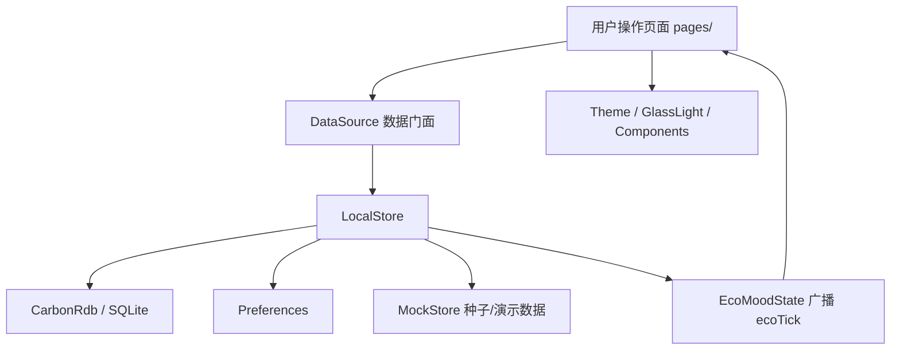

# 一触青绿 · 项目目录结构分析（入门版）

> 本文面向第一次接触本仓库的开发者，目标是把“每个目录是干什么的、用什么框架、代码从哪里读、改了会影响哪里”讲清楚。
>
> 阅读建议：先看第 1～3 章建立全局印象，再看第 4 章（鸿蒙端）和第 11 章（学习路线）。只想快速改代码，可以直接跳到第 12 章“常见任务 → 改哪个目录”。
>
> 更细的代码/页面/方法/接口/数据表索引见 [`项目目录与代码索引-详细版.md`](./项目目录与代码索引-详细版.md)。
>
> 比赛答辩用的 8 分钟逐字稿与问答卡见 [`答辩逐字稿-8分钟.md`](./答辩逐字稿-8分钟.md)。

---

## 1. 先记住三句话

1. **`app/` 是真正的主角**：一个可以安装到鸿蒙手机/模拟器上的单机版 App，负责记录低碳行为、算积分、发徽章/证书、看图表。
2. **数据全部在手机本地**：`LocalStore` 统一管业务状态，落盘到 RDB（SQLite）和 Preferences 两个本地容器，全程没有网络请求。
3. **服务端相关目录已移除**：早期配套的 `server/`（若依 Java）、`admin/`（Vue）、`db/`（MySQL 脚本）不再随仓库分发，需要时从 git 历史中取回。

项目的业务主线可以背成一句话：

```text
记录低碳行为 → 按因子算减排量 → 1 kg = 10 积分 → 积分换权益/树
        ↑                                              ↓
   看板/趋势/分类                                   任务/徽章/证书/券
```

---

## 2. 顶层目录速查

| 目录/文件 | 一句话定位 | 主要技术/框架 | 是运行时程序吗 | 新手关注度 |
|---|---|---|---|---|
| `app/` | 鸿蒙客户端，项目主交付物 | OpenHarmony、ArkTS、ArkUI、RDB、MindSpore Lite | 是 | ★★★★★ |
| `docs/` | 技术方案、UI 方案、架构图 | Markdown、PNG | 否 | ★★★ |
| `tools/` | 文档/图表生成与校验脚本 | Python、python-docx、matplotlib、Node.js | 否 | ★ |
| `business-logic-guide/` | 零基础业务讲解手册 | HTML、JavaScript | 否 | ★★★ |
| `.workbuddy/` | AI 助手的历史记忆、截图、临时脚本 | Markdown、Python、PowerShell | 否 | ☆ |
| `.hvigor/`、`app/.hvigor/` | 鸿蒙构建缓存 | Hvigor | 否 | ☆ |
| `.idea/`、`app/.idea/` | IDE 工程配置 | DevEco Studio / IntelliJ | 否 | ☆ |
| `node_modules/` | 根目录 Node 依赖（文档/图片相关，当前无根 `package.json`） | npm | 否 | ☆ |
| `app/oh_modules/` | 鸿蒙依赖（目前只有测试框架 hypium） | ohpm | 否 | ☆ |
| `README.md` | 仓库总说明（部分内容已过时） | Markdown | 否 | ★★★ |
| `移植说明与接口文档.md` | 早期“四端 + 服务端”移植说明（历史文档） | Markdown | 否 | ★★ |
| `超级终端多设备同步方案.md` | 早期多设备同步设计（当前未启用） | Markdown | 否 | ★ |

---

## 3. 目录树（带注释）

```text
carbon-master/
├── README.md                          # 项目总览、构建与运行方式
├── 移植说明与接口文档.md              # 历史归档：早期四端移植记录（服务端代码已移除）
├── 超级终端多设备同步方案.md          # 多设备同步方案，当前 App 已移除同步引擎
│
├── app/                               # ★ 鸿蒙端（真正运行在手机上的 App）
│   ├── AppScope/                      # 应用级配置：包名、版本、应用图标、应用名
│   ├── entry/                         # 主模块（HAP 的入口模块）
│   │   ├── src/main/
│   │   │   ├── ets/                   # ArkTS 源码（页面、组件、数据层）
│   │   │   │   ├── entryability/      # UIAbility 生命周期入口
│   │   │   │   ├── common/router/     # 全局路由：NavPathStack + RouteName + PageMap
│   │   │   │   ├── pages/             # 页面（按业务域分目录）
│   │   │   │   ├── ui/                # 设计系统：主题、液态玻璃、通用组件、Toast
│   │   │   │   ├── data/              # 数据层：LocalStore、MockStore、RDB、账号、主题
│   │   │   │   ├── net/               # DataSource 本地数据门面（现在没有网络请求）
│   │   │   │   └── utils/             # 时间、剪贴板等工具
│   │   │   └── resources/             # 资源：颜色、字符串、图标、AI 模型
│   │   ├── build/                     # 构建产物（HAP、中间文件，不要手改）
│   │   ├── .preview/                  # DevEco 预览器缓存
│   │   ├── build-profile.json5        # 模块构建配置
│   │   ├── hvigorfile.ts              # 模块构建脚本
│   │   ├── obfuscation-rules.txt      # 代码混淆规则
│   │   └── oh-package.json5           # 模块依赖声明
│   ├── build-profile.json5            # 产品级构建配置：签名、SDK 版本
│   ├── hvigor/                        # Hvigor 构建器配置
│   ├── hvigorfile.ts                  # 工程构建脚本
│   ├── oh-package.json5               # 工程依赖声明
│   ├── oh-package-lock.json5          # 依赖锁定文件
│   ├── oh_modules/                    # 已安装的鸿蒙依赖
│   ├── scripts/                       # 开发脚本：同步 Tabler 图标到资源目录
│   ├── signature/                     # 签名证书（敏感，不要公开）
│   ├── local.properties               # 本机 SDK 路径（不要提交）
│   ├── build-log.txt / build-log2.txt # 旧构建日志（不应长期提交）
│   └── build-check.ps1                # Windows 下的命令行构建脚本
│
├── docs/                              # 当前技术文档
│   ├── 一触青绿_OpenHarmony单机版技术方案_两套.md
│   ├── 液态玻璃与深色模式方案.md
│   └── assets/                        # 架构图、流程图 PNG
│
├── tools/                             # 文档/图表生成脚本（不参与 App 运行）
│   ├── gen_docs.py / gen_tech_doc.py / gen_design_doc*.py
│   ├── gen_diagrams.py / gen_docx_figs.py / gen_work_docx.py
│   ├── theme_dep_wrap.py / theme_verify.py / verify_doc.py
│   ├── strip-unused-imports.js
│   └── diagrams/                      # 生成好的图
│
├── business-logic-guide/              # 零基础业务讲解 HTML
│   ├── business-logic-guide.html
│   └── assets/charts.js
│
├── .workbuddy/                        # AI 助手工作痕迹（记忆、截图、临时脚本）
├── .hvigor/                           # 根级 Hvigor 缓存
├── .idea/                             # IDE 配置
├── node_modules/                      # 根目录 Node 依赖（文档/图片工具用）
└── .gitignore                         # Git 忽略规则
```

---

## 4. `app/` 鸿蒙端详解

### 4.1 它在项目里的角色

`app/` 是一个 **OpenHarmony 单机应用**：

- 技术栈：**ArkTS 语言 + ArkUI 声明式 UI**
- 兼容 API：`compatibleSdkVersion = 24`
- 路由：`Navigation + NavPathStack`，不是传统的 `@ohos.router`
- 本地存储：**Preferences（轻量键值）+ RDB/SQLite（业务数据）**
- 端侧 AI：**MindSpore Lite + MobileNetV2**
- 构建工具：**Hvigor**
- 包管理：**ohpm**
- 安装包：**HAP**
- 源码规模：约 60 个 `.ets`，约 3.5 万行
- 构建产物：`entry-default-signed.hap`，约 18MB

### 4.2 `app/` 根目录文件

| 文件/目录 | 作用 | 新手要不要动 |
|---|---|---|
| `AppScope/app.json5` | 应用级配置：`bundleName`、版本号、应用名、图标 | 发布前要改成正式包名 |
| `AppScope/resources/` | 应用级资源：应用图标、应用名字符串 | 改图标/名称时动 |
| `build-profile.json5` | 产品配置：签名、`compileSdkVersion`、`compatibleSdkVersion`、`runtimeOS` | 改签名/SDK 时动，平时别动 |
| `hvigorfile.ts` | 工程级构建脚本 | 基本不动 |
| `hvigor/hvigor-config.json5` | Hvigor 构建器参数 | 基本不动 |
| `oh-package.json5` | 工程依赖声明（当前无运行时第三方依赖） | 加依赖时动 |
| `oh-package-lock.json5` | 依赖版本锁定 | 由 ohpm 生成 |
| `oh_modules/` | 已安装的鸿蒙依赖（主要是测试框架 hypium） | 不要手改 |
| `local.properties` | 本机 DevEco SDK 路径（当前是 `D:/anzhi/SDK`） | 每台机器不同，不要提交 |
| `signature/` | 签名证书、profile、p7b 等 | **敏感，不要公开** |
| `build-check.ps1` | Windows 命令行构建脚本 | 构建排错时看 |
| `build-log*.txt` | 历史构建日志 | 只读，建议不要提交 |
| `entry/` | 主模块，所有业务代码在这里 | ★ 主要工作区 |

### 4.3 `AppScope/`

应用级（整个 App）而不是模块级：

- `app.json5`：包名 `com.example.yichuqinglv`、版本 `1.0.0`、`versionCode`
- `resources/base/element/string.json`：应用名
- `resources/base/media/app_icon.png`：应用图标

可以把它理解成 Android 的 `AndroidManifest` + 应用级资源。

### 4.4 `entry/`

`entry` 是鸿蒙的“主模块”，最终会被打包成 HAP。

| 文件 | 作用 |
|---|---|
| `src/main/module.json5` | 模块声明：模块名、设备类型、入口 Ability、页面配置、权限 |
| `src/main/ets/` | ArkTS 源码 |
| `src/main/resources/` | 模块资源 |
| `build-profile.json5` | 模块构建配置 |
| `hvigorfile.ts` | 模块构建脚本 |
| `obfuscation-rules.txt` | 代码混淆规则 |
| `oh-package.json5` | 模块依赖 |
| `build/` | 编译产物（HAP、中间文件） |
| `.preview/` | 预览器缓存 |

`module.json5` 里几个关键点：

- `mainElement: "EntryAbility"`：应用启动入口
- `pages: "$profile:main_pages"`：页面清单
- `requestPermissions`：权限声明（当前仍声明了网络/分布式权限，但代码已不走网络，见第 14 章）
- `metadata: ohos.extension.colorMode = auto`：深色模式跟随系统

### 4.5 `entry/src/main/ets/` 代码分层

这是最重要的目录。建议按“入口 → 路由 → 页面 → 数据”的顺序读。

| 子目录 | 作用 | 关键文件 | 新手先看什么 |
|---|---|---|---|
| `entryability/` | 应用生命周期入口 | `EntryAbility.ets` | App 启动时做了什么 |
| `common/router/` | 全局路由 | `AppRouter.ets`、`PageMap.ets` | 页面怎么跳转、路由名在哪注册 |
| `pages/` | 所有页面 | `Index.ets`、各业务页 | UI 和交互 |
| `ui/` | 设计系统/通用组件 | `Theme.ets`、`GlassLight.ets`、`Components.ets` | 颜色、玻璃效果、通用卡片 |
| `data/` | 数据层 | `LocalStore.ets`、`rdb/CarbonRdb.ets`、`MockStore.ets` | 数据从哪来、存到哪 |
| `net/` | 数据门面 | `DataSource.ets` | 页面调用的统一入口（现在纯本地） |
| `utils/` | 工具 | `AppClock.ets`、`Clipboard.ets` | 时间口径、剪贴板 |

#### 4.5.1 `entryability/EntryAbility.ets`

App 的“启动总开关”，负责：

1. 把 `appContext` 放进 `AppStorage`，供数据层拿应用上下文
2. 初始化账号系统 `AccountStore.init()`
3. 初始化碳情绪状态 `EcoMoodState.init()`
4. 初始化深色模式 `ThemeMode.init()`
5. 创建窗口时设置系统栏透明、加载 `pages/Index`
6. 启动链里继续执行 `AccountStore.init() → LocalStore.init()`

可以把它理解成“App 的 `main()` + 窗口初始化 + 全局状态预热”。

#### 4.5.2 `common/router/`

| 文件 | 作用 |
|---|---|
| `AppRouter.ets` | 全局唯一的 `NavPathStack`，以及所有 `RouteName` 常量 |
| `PageMap.ets` | 把路由名映射到具体页面组件；提供 `go()` / `goWithParam()` |

为什么只有一个 `main_pages.json` 页面？因为所有子页面都通过 `Navigation` 的 `NavDestination` 动态注册，不需要在 `main_pages.json` 里逐个声明。

跳转链路：

```text
页面调用 go(RouteName.XXX)
  → AppRouter.pathStack.pushPathByName(...)
  → Index 的 Navigation.navDestination
  → PageMap(name) 匹配到对应页面组件
```

#### 4.5.3 `pages/`

按业务域分目录，便于定位：

| 目录 | 业务 | 代表页面 |
|---|---|---|
| `pages/Index.ets` | 主框架 | 四个 Tab、底部胶囊导航、Splash/引导/登录门 |
| `pages/SplashPage.ets` | 启动页 | 品牌动画 |
| `pages/OnboardingPage.ets` | 首次引导 | 功能介绍 |
| `pages/auth/` | 登录/注册 | `LoginGate.ets` |
| `pages/dashboard/` | 首页看板 | 今日/本月/累计、趋势入口 |
| `pages/record/` | 行为记录列表 | `RecordListPage.ets` |
| `pages/behavior/` | 行为录入/详情/因子/AI | `BehaviorAddSheet`、`FactorLibPage`、`AiRecognizePage` |
| `pages/chart/` | 图表 | `TrendChartPage`、`CategoryAnalysisPage` |
| `pages/points/` | 积分体系 | 积分首页、流水、任务、商城、徽章、证书、券包 |
| `pages/article/` | 科普内容 | 列表、详情、收藏、答题 |
| `pages/mine/` | 我的 | `MinePage`、等级树、个人资料 |
| `pages/settings/` | 设置 | 备份、导出、月账单、家庭、关于、调试 |
| `pages/smart/` | 智慧建议 | `SmartTipsPage` |
| `pages/terminal/` | 超级终端 | `SuperTerminalPage`（当前是本地演示数据） |

页面数量很多，但结构一致：`aboutToAppear()` 里调 `DataSource.xxx()`，拿到数据后刷新 `@State`，再用 `build()` 画 UI。

#### 4.5.4 `ui/`

| 文件 | 作用 |
|---|---|
| `Theme.ets` | 颜色令牌、字体、圆角、间距、业务常量 `Biz`（积分/树/等级） |
| `GlassLight.ets` | 液态玻璃光照模型：135° 光源、材质参数、预合成渐变 |
| `GlassSurface.ets` | 玻璃表面组件（pill/card/panel 三档） |
| `GlassDialog.ets` | 玻璃弹窗 |
| `Components.ets` | 通用组件：卡片、胶囊、进度条、顶部栏、空状态 |
| `AppleMotion.ets` | 动画曲线/时长 |
| `LazyList.ets` | 懒加载列表 |
| `Toast.ets` | 轻提示 |

如果要改“颜色、玻璃、通用卡片”，先看这里，不要直接在页面里写死色值。

#### 4.5.5 `data/`

数据层是当前项目的核心，也是最近改动最大的地方。

| 文件/目录 | 作用 |
|---|---|
| `LocalStore.ets` | **业务数据唯一入口**：记录、积分、券、任务领取、文章互动、备份、统计 |
| `rdb/CarbonRdb.ets` | SQLite 封装：建表、索引、增删改查、聚合、分页、事务、内存态兜底 |
| `MockStore.ets` | 演示数据/种子数据：27 因子、10 文章、8 权益、设备/家庭演示数据、AI 关键词 |
| `AccountStore.ets` | 本地账号表、登录态、资料、密码哈希 |
| `ThemeMode.ets` | 深色模式：读盘、跟随系统、手动锁定、系统栏反色 |
| `EcoMoodState.ets` | 碳情绪四档：按今日减排量决定全屏配色档位 |
| `ai/AiVisionRecognizer.ets` | 端侧 AI：加载 `mobilenetv2.ms`、选图、推理、关键词映射 |

存储分层：

```text
业务数据（会增长）     → RDB/SQLite：carbon.db
  - 行为记录
  - 券
  - 任务领取
  - 文章互动
  - 备份快照

轻量键值（很小）       → Preferences：yichu_qinglv
  - 登录态/账号表
  - 种子标记
  - 备份份数/时间
  - 迁移标记
  - 可用积分余额
```

`CarbonRdb` 的五张表：

| 表 | 用途 |
|---|---|
| `carbon_record` | 行为记录（无上限增长，重点优化对象） |
| `carbon_coupon` | 兑换券流水 |
| `task_claim` | 每日任务领取记录 |
| `article_interact` | 文章点赞/收藏 |
| `backup_slot` | 备份快照（当前只有一份） |

#### 4.5.6 `net/DataSource.ets`

名字叫 `net`，但**现在没有任何网络请求**。它是页面统一调用的“数据门面”：

```text
页面 → DataSource → LocalStore → CarbonRdb / Preferences
```

这么设计的好处：页面不需要知道数据来自 RDB 还是内存，方法名也保持稳定；以后如果真加云同步，可以在这里接。

#### 4.5.7 `utils/`

- `AppClock.ets`：统一“今天/本月/日期字符串”的口径，避免跨时区/跨天统计错乱
- `Clipboard.ets`：复制分享文案等

### 4.6 `entry/src/main/resources/`

| 目录/文件 | 作用 |
|---|---|
| `base/element/color.json` | 基础颜色资源 |
| `base/element/string.json` | 字符串资源（权限说明等） |
| `base/media/app_icon.png` | 模块图标 |
| `base/media/ic_*.svg` | 95 个业务图标（白色线稿，运行时由 `CfIcon` 染色） |
| `base/profile/main_pages.json` | 页面清单（只有 `pages/Index`） |
| `zh_CN/element/`、`en_US/element/` | 多语言资源目录（当前基本为空） |
| `rawfile/mobilenetv2.ms` | 端侧 AI 模型，约 14MB |

**图标怎么改**：业务图标不手画、也不在页面里写 emoji。

- 矢量图标来自 Tabler Icons，用 `app/scripts/sync-icons.sh` 同步进 `base/media/`，脚本会把 `currentColor` 烘焙成白色；
- 页面只写语义 code（如 `'home'`、`'receipt'`），由 `common/icons/IconMap.ets` 映射到资源，`ui/Icon.ets` 的 `CfIcon` 负责尺寸与主题染色；
- 卡通 emoji 只保留在“情绪位”：用户头像、徽章原画、看板植物等级、空态插画、答题庆祝；
- 想换回线稿的空态，给 `CfEmpty` 加 `line: true`（AI 识图、证书夹就是这么做的）。

### 4.7 构建产物与缓存（不要手改）

| 路径 | 说明 |
|---|---|
| `app/entry/build/` | HAP 和中间产物；最终包在 `build/default/outputs/default/` |
| `app/entry/.preview/` | DevEco 预览器缓存 |
| `app/.hvigor/`、根 `.hvigor/` | Hvigor 构建缓存 |
| `app/.idea/`、根 `.idea/` | IDE 配置 |
| `app/oh_modules/` | 鸿蒙依赖 |
| 根 `node_modules/` | Node 依赖（文档/图片工具用，App 不依赖） |

### 4.8 App 是怎么跑起来的

```text
1. 系统启动 EntryAbility
2. EntryAbility.onCreate()
   - 保存 appContext
   - AccountStore.init()       恢复账号表/上次会话
   - EcoMoodState.init()       初始化碳情绪档位
   - ThemeMode.init()          初始化深色模式
3. EntryAbility.onWindowStageCreate()
   - 设置系统栏透明
   - loadContent('pages/Index')
   - AccountStore.init() → LocalStore.init()（打开 RDB、迁移旧数据、必要时灌种子）
4. Index 创建
   - Splash / Onboarding / LoginGate / 四个 Tab
5. 页面 aboutToAppear()
   - DataSource.xxx() → LocalStore.xxx() → RDB/Preferences
6. 用户写数据
   - LocalStore 写 RDB/Preferences → 广播 ecoTick/themeTick → 页面自动重拉
```

### 4.9 新手改 App 时从哪里下手

| 想做的事 | 先看 |
|---|---|
| 改首页看板 | `pages/dashboard/DashboardPage.ets` + `data/LocalStore.ets` 的 `stats()` |
| 加一种低碳行为 | `data/MockStore.ets` 因子表 + `pages/behavior/BehaviorAddSheet.ets` |
| 改积分规则 | `ui/Theme.ets` 的 `Biz` + `data/LocalStore.ets` |
| 改颜色/深色模式 | `ui/Theme.ets`、`ui/GlassLight.ets`、`data/ThemeMode.ets` |
| 加一个页面 | `pages/` 新建 + `common/router/AppRouter.ets` 加 RouteName + `PageMap.ets` 注册 |
| 改数据存储 | `data/LocalStore.ets`、`data/rdb/CarbonRdb.ets` |
| 改 AI 识别 | `data/ai/AiVisionRecognizer.ets` + `pages/behavior/AiRecognizePage.ets` |

### 4.10 鸿蒙术语小抄

| 术语 | 解释 |
|---|---|
| ArkTS | 鸿蒙的 TypeScript 方言，写业务逻辑 |
| ArkUI | 鸿蒙声明式 UI 框架，用 `@Component` + `build()` 描述界面 |
| `@Entry` | 页面入口标记，一个页面只有一个 |
| `@Component` | 自定义组件标记 |
| `@State` | 组件内部响应式状态，变了会刷新 UI |
| `@StorageProp` / `@StorageLink` | 和全局 `AppStorage` 绑定的响应式状态 |
| HAP | Harmony Ability Package，鸿蒙安装包 |
| Hvigor | 鸿蒙构建工具（类似 Gradle） |
| ohpm | 鸿蒙包管理器（类似 npm） |
| RDB | Relational Database，鸿蒙对 SQLite 的封装 |
| Preferences | 鸿蒙轻量键值存储（类似 SharedPreferences） |
| NavPathStack | Navigation 的页面栈 |
| NavDestination | Navigation 的子页面容器 |
| MindSpore Lite | 端侧 AI 推理框架 |

---

## 5. `docs/` 文档

| 文件 | 内容 | 适合谁看 |
|---|---|---|
| `docs/一触青绿_OpenHarmony单机版技术方案_两套.md` | 单机版两套技术方案，方案二（RDB）已落地 | 想看架构选型、数据层设计的人 |
| `docs/液态玻璃与深色模式方案.md` | 液态玻璃光照模型、深色模式换血、组件规范、性能红线 | 改 UI/主题的人 |
| `docs/assets/` | 架构图、记录流程图、AI 流程图、模块图 | 写文档/答辩的人 |

根目录还有两份历史文档：

| 文件 | 说明 |
|---|---|
| `移植说明与接口文档.md` | 早期“源单机项目 → RuoYi 四端”的移植记录，接口/表结构说明仍可参考，但架构已变化 |
| `超级终端多设备同步方案.md` | 多设备同步设计，当前 App 已移除同步引擎，属于历史方案 |

读文档时要注意“时间线”：**单机版技术方案 > 移植说明 > 超级终端方案**（按当前代码实际状态排序）。

---

## 6. `tools/` 辅助脚本

这些脚本不参与 App 运行，主要用于生成 Word/PNG 文档、检查主题依赖、清理未使用 import。

| 脚本 | 作用 |
|---|---|
| `gen_docs.py` | 生成项目文档 |
| `gen_tech_doc.py` | 生成双方案技术文档 |
| `gen_design_doc.py` / `gen_design_doc_v2.py` | 生成设计方案 Word |
| `gen_diagrams.py` | 生成架构/流程图 |
| `gen_docx_figs.py` | 生成 Word 插图 |
| `gen_work_docx.py` | 生成工作文档 |
| `gen_ui_talk.py` | 生成 UI 讲解材料 |
| `theme_dep_wrap.py` | 主题依赖包装/批量改代码 |
| `theme_verify.py` | 主题一致性校验 |
| `verify_doc.py` | 文档校验 |
| `strip-unused-imports.js` | 清理未使用 import |
| `tools/diagrams/` | 生成好的系统图/功能图/流程图 |

注意：

- 多数脚本里有 Windows 绝对路径（如 `D:\11\carbon-master\...`），换机器要改路径
- 依赖 `python-docx`、`matplotlib`、`Pillow`、`python-docx` 等
- 这些脚本是“文档生产线”，不是产品代码

---

## 7. `business-logic-guide/`

这是一个**零基础业务讲解 HTML**，适合：

- 第一次接触项目的人
- 答辩/汇报前快速回顾
- 不想读代码、先理解业务的人

主要章节：

1. 这个 App 是干什么的
2. 核心业务主线
3. 账是怎么算的（减排/积分/变色）
4. 页面地图：27 个页面各自干什么
5. 数据存在哪：分层与广播
6. 三大亮点功能拆解
7. 动手测试清单
8. 5 分钟讲稿 + 问答锦囊
9. 手册事实来源（核心代码文件）

直接浏览器打开 `business-logic-guide.html` 即可。

---

## 8. `.workbuddy/`

这是 AI 助手的工作痕迹，不是产品代码：

| 路径 | 内容 |
|---|---|
| `.workbuddy/memory/` | 每日工作记忆、长期约定 `MEMORY.md` |
| `.workbuddy/tmp/` | 临时脚本、截图、校验输出 |
| `.workbuddy/crop_*.png` | UI 截图裁剪，用于像素级比对 |

新手可以把它当“开发日志”看，但不要把它当项目源码。

---

## 9. 缓存、依赖、IDE 目录（不要提交/不要手改）

| 路径 | 说明 | 建议 |
|---|---|---|
| `.git/` | Git 版本库 | 不要手改 |
| `.hvigor/`、`app/.hvigor/` | Hvigor 构建缓存 | 可删，重新构建会生成 |
| `.idea/`、`app/.idea/` | IDE 配置 | 不要提交 |
| `node_modules/` | 根 Node 依赖 | 不要提交；当前没有根 `package.json`，可能是历史遗留 |
| `app/oh_modules/` | 鸿蒙依赖 | 由 ohpm 安装，不要手改 |
| `app/entry/build/`、`app/entry/.preview/` | 构建/预览产物 | 不要提交 |
| `app/local.properties` | 本机 SDK 路径 | 不要提交（每台机器不同） |
| `app/signature/` | 签名证书/密码材料 | 敏感，不要公开 |
| `app/build-log*.txt` | 旧构建日志 | 建议移出版本库 |

---

## 10. 模块之间怎么协作

### 10.1 App 内部



---

## 11. 新手阅读路线

### 路线 A：只想把 App 跑起来、看界面

1. 读 `README.md` 的“环境要求”和“鸿蒙端”部分
2. 用 DevEco Studio 打开 `app/`
3. 确认 SDK 为 API 24
4. 运行 `entry`
5. 按 `business-logic-guide.html` 的“动手测试清单”点一遍

### 路线 B：想改 App 功能

1. `pages/Index.ets`：主框架、Tab、底部导航
2. `common/router/AppRouter.ets` + `PageMap.ets`：页面怎么跳
3. 选一个业务页，例如 `pages/record/RecordListPage.ets`
4. 跟着它调用的 `DataSource.xxx()` 进 `data/LocalStore.ets`
5. 再看 `data/rdb/CarbonRdb.ets` 的 SQL
6. 改颜色/组件时看 `ui/Theme.ets`、`ui/GlassLight.ets`、`ui/Components.ets`

### 路线 C：想写文档/答辩

1. `docs/一触青绿_OpenHarmony单机版技术方案_两套.md`
2. `docs/液态玻璃与深色模式方案.md`
3. `business-logic-guide.html`
4. `docs/assets/` 里的架构图/流程图
5. `tools/` 里的生成脚本（需要重新生成 Word/图时）

---

## 12. 常见任务 → 改哪个目录

| 你想做的事 | 主要改这里 | 可能还要改 |
|---|---|---|
| 改 App 首页/看板 | `app/entry/src/main/ets/pages/dashboard/` | `data/LocalStore.ets` 统计口径 |
| 加一种低碳行为因子 | `app/.../data/MockStore.ets` | `pages/behavior/`、`data/rdb/CarbonRdb.ets` 迁移逻辑 |
| 改积分/等级/植树规则 | `app/.../ui/Theme.ets` 的 `Biz` | `LocalStore` 里的口径与文案 |
| 改深色模式/玻璃效果 | `app/.../ui/Theme.ets`、`GlassLight.ets`、`data/ThemeMode.ets` | `docs/液态玻璃...md` |
| 加一个 App 页面 | `app/.../pages/` 新建 | `AppRouter.ets` 加 RouteName、`PageMap.ets` 注册 |
| 改本地数据库表 | `app/.../data/rdb/CarbonRdb.ets` | `LocalStore.ets`、迁移逻辑 |
| 重新生成文档/图 | `tools/` | `docs/`、`docs/assets/` |
| 改应用名/包名/图标 | `app/AppScope/app.json5` | `app/AppScope/resources/`、`app/entry/src/main/resources/` |
| 改权限 | `app/entry/src/main/module.json5` | 隐私说明、上架材料 |
| 改构建/签名 | `app/build-profile.json5`、`app/signature/` | `app/local.properties` |

---

## 13. 不要改 / 不要提交的东西

### 不要手改

- `app/entry/build/`
- `app/entry/.preview/`
- `.hvigor/`、`app/.hvigor/`
- `app/oh_modules/`
- 根 `node_modules/`
- `.idea/`、`app/.idea/`
- `*.hap`
- `app/build-log*.txt`

### 不要公开

- `app/signature/` 下的证书、`p12`、`p7b`
- `app/build-profile.json5` 里的签名密码

### 不要盲信

- `移植说明与接口文档.md` 里的服务端架构（对应代码已删除，仅作历史参考）
- `超级终端多设备同步方案.md` 里的分布式同步（当前未启用）
- `data/MockStore.ets` 顶部的“后端未启动时兜底”注释（现在它是主数据源之一）

---

## 14. 当前项目状态提醒（读代码前必看）

这部分不是目录说明，但会直接影响你理解代码：

1. **App 是单机版**：页面不调 HTTP，`net/DataSource.ets` 只是本地门面；`ApiService.ets`、`HttpClient.ets`、`AppConfig.ets` 已删除。
2. **仓库里已没有任何服务端代码**：`server/`、`admin/`、`db/` 三个目录已整体移除，只剩 `app/` 与 RDB 本地库。
3. **数据层正在从 Preferences 迁到 RDB**：`LocalStore.ets` 和新增的 `data/rdb/CarbonRdb.ets` 是最近改动重点；工作区还有大量未提交修改。
4. **工作区有大量换行符噪声**：`git status` 显示 400+ 文件变更，但大部分只是 CRLF/LF 差异，真正逻辑改动约 47 个文件。
5. **权限声明未清理**：`module.json5` 仍申请 INTERNET、GET_NETWORK_INFO、DISTRIBUTED_DATASYNC，但代码已不走网络/分布式。
6. **备份只有一份槽位**：UI 显示“已备份份数”，实际 RDB 的 `backup_slot` 只有最近一份；备份只含记录 + 券。
7. **没有自动化测试/CI**：`ohosTest` 只有 `.gitkeep`。
8. **构建环境是 Windows**：`local.properties` 指向 `D:/anzhi/SDK`，`build-check.ps1` 用 PowerShell；当前 Linux 环境无法直接构建 App。
9. **最后一次 HAP 构建**：2026-10-24 17:46，约 18MB。

---

## 15. 术语总表

| 术语 | 一句话解释 |
|---|---|
| OpenHarmony | 开源鸿蒙操作系统 |
| ArkTS | 鸿蒙的 TypeScript 方言 |
| ArkUI | 鸿蒙声明式 UI 框架 |
| HAP | 鸿蒙安装包 |
| Hvigor | 鸿蒙构建工具 |
| ohpm | 鸿蒙包管理器 |
| RDB | 鸿蒙关系型数据库（SQLite） |
| Preferences | 鸿蒙轻量键值存储 |
| UIAbility | 鸿蒙应用组件，负责生命周期和窗口 |
| Navigation | 鸿蒙页面导航容器 |
| NavPathStack | Navigation 的页面栈 |
| NavDestination | Navigation 的子页面 |
| MindSpore Lite | 端侧 AI 推理框架 |
| SQLite | 轻量嵌入式数据库，RDB 的底层实现 |
| SQL | 数据库查询语言 |
| 种子数据 | 初始化时预置的数据 |
| Mock | 模拟数据/模拟接口 |

---

## 16. 一页速查

```text
想跑 App            → app/ + DevEco Studio
想看业务讲解        → business-logic-guide/business-logic-guide.html
想改界面            → app/entry/src/main/ets/pages/
想改通用组件/主题   → app/entry/src/main/ets/ui/
想改数据/存储       → app/entry/src/main/ets/data/
想加页面            → pages/ + common/router/AppRouter.ets + PageMap.ets
想看本地表结构      → app/entry/src/main/ets/data/rdb/CarbonRdb.ets
想看架构/UI 方案    → docs/
想生成文档/图       → tools/
想了解当前改动状态  → 第 14 章
```

---

> 最后建议：第一次读这个项目，不要从几百个文件里随机点。按“**App 主链路 → 数据层**”的顺序看，先建立“页面 → DataSource → LocalStore → RDB”的主干，再扩展到积分、任务、文章、家庭等分支，效率最高。
